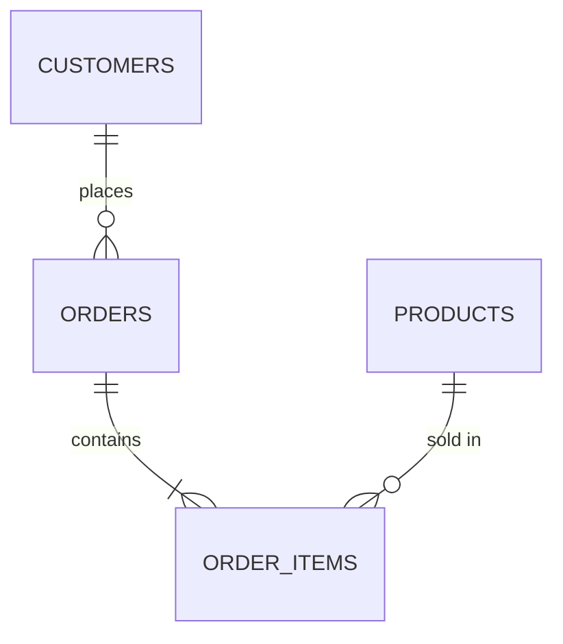

# 150 Python Practice Problems for Data Analytics & Data Science

A self-study collection of **150 Python problems** in three levels: **50 beginner, 50 intermediate and 50 advanced**. Every problem uses the same small set of sample datasets, so you can run each answer and compare your output with the result shown. All results were produced by running the code with Python 3, pandas 3.0, NumPy 2.5, SciPy 1.18 and scikit-learn 1.9.

| Level | Topics |
|---|---|
| 🟢 **Beginner** (B01–B50) | Lists, dictionaries, comprehensions, functions, f-strings, `Counter`, loading CSVs, inspecting data (`shape`, `head`, `dtypes`, `describe`), selecting and filtering (`isin`, `between`, `query`), sorting, `value_counts`, missing values (`isna`, `fillna`, `dropna`), new columns, dates (`to_datetime`, `.dt`), `groupby` + `agg`, `merge`, `concat`, duplicates, string cleaning, `map`, `apply`, `np.where`, `pd.cut`, `crosstab`, `pivot_table` |
| 🟡 **Intermediate** (I01–I50) | Named aggregation, multi-table joins, periods and `resample`, growth rates, rolling and expanding windows, `transform`, ranking and top-N per group, reshaping (`melt`, `pivot`, `stack`/`unstack`), `np.select`, `qcut`, outliers (IQR, z-score), cleaning messy prices, dates and names, deduplication, group-wise imputation, `ffill`/`interpolate`, `diff`, `cumcount`, recency, retention-style metrics, anti-joins, join validation, `explode`, Pareto analysis, YoY comparisons, sampling, NumPy broadcasting and percentiles, date spines, ordered categoricals, reusable functions |
| 🔴 **Advanced** (A01–A50) | RFM scoring and segmentation, cohort retention, CLV, market basket analysis (support, confidence, lift), A/B testing (z-test, chi-square, Welch t-test, Mann-Whitney, bootstrap, permutation test, sample size), confidence intervals, correlation, regression, scikit-learn pipelines (`ColumnTransformer`, logistic regression, random forest), evaluation (confusion matrix, ROC AUC, cross-validation, threshold tuning, lift tables, permutation importance), `GridSearchCV`, class imbalance, K-means and silhouette, PCA, seasonality, forecast backtesting, exponential smoothing, anomaly detection, `merge_asof`, rolling windows per group, memory optimisation, method chaining, MultiIndex, `json_normalize`, regex extraction, data quality reports, Gini/Lorenz, KPI tables |

---

## Setup

1. Install the libraries:
   ```cmd
   pip install pandas numpy scipy scikit-learn tabulate
   ```
2. Create the sample data. [`00_make_data.py`](00_make_data.py) writes seven CSV files to a `data/` folder. It uses a fixed random seed, so the data is identical on every run:
   ```cmd
   python 00_make_data.py
   ```
3. Start every session (a notebook or a script in the project folder) with the setup code below. Each problem assumes these tables are loaded and **unchanged**.

```python
import pandas as pd
import numpy as np

customers   = pd.read_csv("data/customers.csv")
products    = pd.read_csv("data/products.csv")
orders      = pd.read_csv("data/orders.csv", parse_dates=["order_date"])
order_items = pd.read_csv("data/order_items.csv")
ab_test     = pd.read_csv("data/ab_test.csv")
churn       = pd.read_csv("data/churn.csv")
messy       = pd.read_csv("data/messy_sales.csv")

# One row per order line, with order, product and revenue details
sales = (order_items
         .merge(orders, on="order_id")
         .merge(products[["product_id", "product_name", "category", "cost"]], on="product_id"))
sales["revenue"] = (sales["quantity"] * sales["unit_price"] * (1 - sales["discount_pct"] / 100)).round(2)
sales["profit"] = (sales["revenue"] - sales["quantity"] * sales["cost"]).round(2)
```

> **Revenue definitions used throughout:** *gross* = `quantity × unit_price`; *net revenue* (`sales["revenue"]`) applies the order's `discount_pct`; *profit* = net revenue − `quantity × cost`. Unless a problem says otherwise, revenue figures count **Completed** orders only.
>
> Long results are cut after 15 rows (the total row count is shown underneath). Random elements (sampling, bootstrap, models, K-means) use a fixed `random_state` or seed so your output matches.

## Sample Datasets

The data describes a fictional online retailer selling to customers in the Baltic states and Poland (2023–2024), plus two analysis datasets for experiments and machine learning.

| Table | Rows | Description |
|---|---:|---|
| `customers` | 40 | Customer name, city, country, age, segment, signup date and email (some ages and emails missing) |
| `products` | 15 | Product name, category, list price, unit cost and stock |
| `orders` | 240 | Order date, customer, channel (Web/App/Store), status (Completed/Cancelled/Returned), discount % and shipping days |
| `order_items` | 502 | Order lines: product, quantity and unit price |
| `ab_test` | 2,000 | Website experiment: group A/B, device, converted flag and revenue |
| `churn` | 800 | Subscription customers: tenure, contract, monthly charges, support tickets, logins, payment method and churn flag |
| `messy_sales` | 15 | A deliberately dirty export: mixed date formats, prices as text, inconsistent case and spaces, duplicates and invalid values |
| **Total** | **3,612** | |



The data includes useful edge cases: customers without orders, a product that was never sold, missing values, cancelled and returned orders, and orders dated before the customer's signup date.

### How to use these notes

1. Read the **Problem** and try to solve it yourself first.
2. Compare your code with the **Answer** and your output with the **Result**.
3. Read the 💡 note: it explains the key idea or a common pitfall.
4. Write down an alternative solution. Most problems have more than one good answer.

## Contents

### 🟢 Beginner

| | |
|---|---|
| [B01](#b01-total-and-average-of-a-list) Total and average of a list | [B26](#b26-drop-rows-with-missing-values) Drop rows with missing values |
| [B02](#b02-most-and-least-expensive-product) Most and least expensive product | [B27](#b27-rename-columns) Rename columns |
| [B03](#b03-add-vat-with-a-dictionary-comprehension) Add VAT with a dictionary comprehension | [B28](#b28-add-calculated-columns) Add calculated columns |
| [B04](#b04-days-above-average) Days above average | [B29](#b29-convert-text-to-dates) Convert text to dates |
| [B05](#b05-percentage-change-function) Percentage change function | [B30](#b30-extract-date-parts) Extract date parts |
| [B06](#b06-formatted-text-report) Formatted text report | [B31](#b31-group-and-sum) Group and sum |
| [B07](#b07-count-categories-with-counter) Count categories with Counter | [B32](#b32-group-and-average) Group and average |
| [B08](#b08-build-a-dictionary-from-two-lists) Build a dictionary from two lists | [B33](#b33-several-aggregations-at-once) Several aggregations at once |
| [B09](#b09-sort-a-list-of-records) Sort a list of records | [B34](#b34-merge-two-tables) Merge two tables |
| [B10](#b10-load-a-csv-file) Load a CSV file | [B35](#b35-find-customers-without-orders) Find customers without orders |
| [B11](#b11-preview-the-first-rows) Preview the first rows | [B36](#b36-stack-two-tables) Stack two tables |
| [B12](#b12-check-column-data-types) Check column data types | [B37](#b37-remove-duplicate-rows) Remove duplicate rows |
| [B13](#b13-summary-statistics) Summary statistics | [B38](#b38-clean-text-columns) Clean text columns |
| [B14](#b14-select-columns) Select columns | [B39](#b39-search-text) Search text |
| [B15](#b15-filter-rows-by-one-condition) Filter rows by one condition | [B40](#b40-map-values-with-a-dictionary) Map values with a dictionary |
| [B16](#b16-filter-rows-by-several-conditions) Filter rows by several conditions | [B41](#b41-apply-a-custom-function) Apply a custom function |
| [B17](#b17-filter-with-isin) Filter with isin | [B42](#b42-flag-rows-with-npwhere) Flag rows with np.where |
| [B18](#b18-filter-a-numeric-range) Filter a numeric range | [B43](#b43-bin-ages-into-groups) Bin ages into groups |
| [B19](#b19-sort-values) Sort values | [B44](#b44-share-of-total) Share of total |
| [B20](#b20-top-n-with-nlargest) Top N with nlargest | [B45](#b45-running-total) Running total |
| [B21](#b21-count-values) Count values | [B46](#b46-group-result-as-a-flat-table) Group result as a flat table |
| [B22](#b22-share-of-each-value) Share of each value | [B47](#b47-cross-tabulation) Cross-tabulation |
| [B23](#b23-unique-values) Unique values | [B48](#b48-pivot-table) Pivot table |
| [B24](#b24-count-missing-values) Count missing values | [B49](#b49-filter-with-query) Filter with query |
| [B25](#b25-fill-missing-values-with-the-median) Fill missing values with the median | [B50](#b50-kpi-summary-table) KPI summary table |

### 🟡 Intermediate

| | |
|---|---|
| [I01](#i01-order-totals-from-line-items) Order totals from line items | [I26](#i26-first-and-last-order-per-customer) First and last order per customer |
| [I02](#i02-revenue-and-profit-by-category) Revenue and profit by category | [I27](#i27-recency-days-since-last-order) Recency: days since last order |
| [I03](#i03-monthly-revenue-with-periods) Monthly revenue with periods | [I28](#i28-basket-size-distribution) Basket size distribution |
| [I04](#i04-quarterly-revenue-with-resample) Quarterly revenue with resample | [I29](#i29-cancellation-rate-by-channel) Cancellation rate by channel |
| [I05](#i05-month-over-month-growth) Month-over-month growth | [I30](#i30-orders-by-weekday) Orders by weekday |
| [I06](#i06-three-month-moving-average) Three-month moving average | [I31](#i31-channel-mix-by-segment) Channel mix by segment |
| [I07](#i07-compare-each-order-with-the-customers-average) Compare each order with the customer's average | [I32](#i32-correlation-matrix) Correlation matrix |
| [I08](#i08-rank-products-within-category) Rank products within category | [I33](#i33-vectorised-code-instead-of-apply) Vectorised code instead of apply |
| [I09](#i09-top-2-products-per-category) Top 2 products per category | [I34](#i34-split-lists-and-explode) Split lists and explode |
| [I10](#i10-channel-scorecard) Channel scorecard | [I35](#i35-split-one-column-into-several) Split one column into several |
| [I11](#i11-pivot-table-with-totals) Pivot table with totals | [I36](#i36-validate-a-join) Validate a join |
| [I12](#i12-wide-to-long-with-melt) Wide to long with melt | [I37](#i37-products-never-sold) Products never sold |
| [I13](#i13-long-to-wide-with-pivot) Long to wide with pivot | [I38](#i38-number-each-customers-orders) Number each customer's orders |
| [I14](#i14-unstack-a-grouped-result) Unstack a grouped result | [I39](#i39-cumulative-average) Cumulative average |
| [I15](#i15-multi-condition-labels-with-npselect) Multi-condition labels with np.select | [I40](#i40-revenue-by-price-band) Revenue by price band |
| [I16](#i16-churn-rate-by-price-quartile) Churn rate by price quartile | [I41](#i41-conditional-aggregation) Conditional aggregation |
| [I17](#i17-find-outliers-with-the-iqr-rule) Find outliers with the IQR rule | [I42](#i42-pareto-8020-analysis) Pareto (80/20) analysis |
| [I18](#i18-flag-outliers-with-z-scores) Flag outliers with z-scores | [I43](#i43-year-over-year-growth-by-category) Year-over-year growth by category |
| [I19](#i19-clean-messy-price-text) Clean messy price text | [I44](#i44-random-and-stratified-samples) Random and stratified samples |
| [I20](#i20-parse-mixed-date-formats) Parse mixed date formats | [I45](#i45-standardise-with-numpy-broadcasting) Standardise with NumPy broadcasting |
| [I21](#i21-standardise-product-names) Standardise product names | [I46](#i46-percentiles-with-numpy) Percentiles with NumPy |
| [I22](#i22-deduplicate-customers-by-email) Deduplicate customers by email | [I47](#i47-fill-missing-months-with-zero) Fill missing months with zero |
| [I23](#i23-fill-missing-values-by-group) Fill missing values by group | [I48](#i48-units-by-category-and-quarter) Units by category and quarter |
| [I24](#i24-forward-fill-a-time-series) Forward-fill a time series | [I49](#i49-ordered-categories) Ordered categories |
| [I25](#i25-days-between-orders) Days between orders | [I50](#i50-reusable-summary-function) Reusable summary function |

### 🔴 Advanced

| | |
|---|---|
| [A01](#a01-build-an-rfm-table) Build an RFM table | [A26](#a26-choose-a-decision-threshold) Choose a decision threshold |
| [A02](#a02-rfm-scores-and-segments) RFM scores and segments | [A27](#a27-decile-lift-table) Decile lift table |
| [A03](#a03-cohort-table-counts) Cohort table (counts) | [A28](#a28-linear-regression-marketing-mix) Linear regression: marketing mix |
| [A04](#a04-cohort-retention-rates) Cohort retention rates | [A29](#a29-customer-clustering-with-k-means) Customer clustering with K-means |
| [A05](#a05-simple-customer-lifetime-value) Simple customer lifetime value | [A30](#a30-choosing-k-inertia-and-silhouette) Choosing k: inertia and silhouette |
| [A06](#a06-products-bought-together) Products bought together | [A31](#a31-pca-explained-variance) PCA explained variance |
| [A07](#a07-support-confidence-and-lift) Support, confidence and lift | [A32](#a32-seasonal-index-by-month) Seasonal index by month |
| [A08](#a08-ab-test-summary) A/B test summary | [A33](#a33-forecast-backtest) Forecast backtest |
| [A09](#a09-two-proportion-z-test) Two-proportion z-test | [A34](#a34-exponential-smoothing) Exponential smoothing |
| [A10](#a10-chi-square-test-of-independence) Chi-square test of independence | [A35](#a35-detect-anomalies-with-a-rolling-z-score) Detect anomalies with a rolling z-score |
| [A11](#a11-welchs-t-test-on-revenue) Welch's t-test on revenue | [A36](#a36-match-prices-in-effect-with-merge_asof) Match prices in effect with merge_asof |
| [A12](#a12-bootstrap-confidence-interval) Bootstrap confidence interval | [A37](#a37-rolling-average-per-customer) Rolling average per customer |
| [A13](#a13-confidence-interval-for-a-mean) Confidence interval for a mean | [A38](#a38-reduce-memory-usage) Reduce memory usage |
| [A14](#a14-sample-size-for-an-ab-test) Sample size for an A/B test | [A39](#a39-cleaning-pipeline-with-method-chaining) Cleaning pipeline with method chaining |
| [A15](#a15-mann-whitney-u-test) Mann-Whitney U test | [A40](#a40-custom-aggregation-functions) Custom aggregation functions |
| [A16](#a16-pearson-vs-spearman-correlation) Pearson vs Spearman correlation | [A41](#a41-work-with-a-multiindex) Work with a MultiIndex |
| [A17](#a17-linear-trend-in-monthly-revenue) Linear trend in monthly revenue | [A42](#a42-flatten-nested-json) Flatten nested JSON |
| [A18](#a18-stratified-traintest-split) Stratified train/test split | [A43](#a43-extract-fields-with-regex-named-groups) Extract fields with regex named groups |
| [A19](#a19-preprocessing-with-columntransformer) Preprocessing with ColumnTransformer | [A44](#a44-imbalanced-classes-class-weights) Imbalanced classes: class weights |
| [A20](#a20-logistic-regression-pipeline) Logistic regression pipeline | [A45](#a45-feature-engineering-from-dates) Feature engineering from dates |
| [A21](#a21-confusion-matrix-and-classification-report) Confusion matrix and classification report | [A46](#a46-data-quality-report-function) Data quality report function |
| [A22](#a22-compare-models-with-roc-auc) Compare models with ROC AUC | [A47](#a47-revenue-concentration-lorenz-curve-and-gini) Revenue concentration (Lorenz curve and Gini) |
| [A23](#a23-cross-validation) Cross-validation | [A48](#a48-churn-rate-by-tenure-and-contract) Churn rate by tenure and contract |
| [A24](#a24-feature-importance) Feature importance | [A49](#a49-permutation-test) Permutation test |
| [A25](#a25-hyperparameter-tuning-with-gridsearchcv) Hyperparameter tuning with GridSearchCV | [A50](#a50-yearly-kpi-dashboard-table) Yearly KPI dashboard table |

---

## 🟢 Beginner

### B01. Total and average of a list

**Problem:** A shop recorded its daily sales for one week. Calculate the total, the average and the best day's sales using plain Python.

**Answer:**

```python
sales = [1200, 950, 1430, 1100, 1675, 890, 1320]

total = sum(sales)
average = total / len(sales)
print(f"Total:   {total}")
print(f"Average: {average:.2f}")
print(f"Best:    {max(sales)}")
```

> 💡 `sum()`, `len()` and `max()` work on any list. Formatting with `:.2f` keeps two decimals.

**Result:**

```text
Total:   8565
Average: 1223.57
Best:    1675
```

---

### B02. Most and least expensive product

**Problem:** Given a dictionary of product prices, find the most and the least expensive product.

**Answer:**

```python
prices = {"Laptop": 1299.0, "Mouse": 24.9, "Monitor": 389.0, "Chair": 279.0, "Lamp": 39.9}

most = max(prices, key=prices.get)
least = min(prices, key=prices.get)
print(f"Most expensive:  {most} ({prices[most]})")
print(f"Least expensive: {least} ({prices[least]})")
```

> 💡 `key=prices.get` tells `max()` to compare the dictionary values, but return the key.

**Result:**

```text
Most expensive:  Laptop (1299.0)
Least expensive: Mouse (24.9)
```

---

### B03. Add VAT with a dictionary comprehension

**Problem:** Add 21% VAT to every price and round to two decimals.

**Answer:**

```python
prices = {"Laptop": 1299.0, "Mouse": 24.9, "Monitor": 389.0, "Chair": 279.0, "Lamp": 39.9}

with_vat = {name: round(price * 1.21, 2) for name, price in prices.items()}
with_vat
```

> 💡 A comprehension builds a new dictionary in one line: `{key: value for ... in ...}`.

**Result:**

| key | value |
|---|---|
| Laptop | 1571.79 |
| Mouse | 30.13 |
| Monitor | 470.69 |
| Chair | 337.59 |
| Lamp | 48.28 |

---

### B04. Days above average

**Problem:** List the weekdays on which sales were above the weekly average.

**Answer:**

```python
days = ["Mon", "Tue", "Wed", "Thu", "Fri", "Sat", "Sun"]
sales = [1200, 950, 1430, 1100, 1675, 890, 1320]

avg = sum(sales) / len(sales)
above = [day for day, value in zip(days, sales) if value > avg]
above
```

> 💡 `zip()` pairs two lists element by element; the `if` in a comprehension filters items.

**Result:**

```text
['Wed', 'Fri', 'Sun']
```

---

### B05. Percentage change function

**Problem:** Write a function that returns the percentage change between two values and returns `None` when the old value is zero.

**Answer:**

```python
def pct_change(old, new):
    if old == 0:
        return None
    return round((new - old) / old * 100, 2)

print(pct_change(200, 250))
print(pct_change(250, 200))
print(pct_change(0, 100))
```

> 💡 Guarding against division by zero is a habit worth building early; pandas has `.pct_change()` for whole columns.

**Result:**

```text
25.0
-20.0
None
```

---

### B06. Formatted text report

**Problem:** Print an aligned revenue report with thousands separators.

**Answer:**

```python
revenue = {"Vilnius": 125430.5, "Kaunas": 84210.0, "Riga": 9875.25}

print(f"{'City':<10}{'Revenue':>14}")
for city, value in revenue.items():
    print(f"{city:<10}{value:>14,.2f}")
print(f"{'Total':<10}{sum(revenue.values()):>14,.2f}")
```

> 💡 `<` left-aligns and `>` right-aligns; `,` adds thousands separators inside an f-string.

**Result:**

```text
City             Revenue
Vilnius       125,430.50
Kaunas         84,210.00
Riga            9,875.25
Total         219,515.75
```

---

### B07. Count categories with Counter

**Problem:** Count how often each category appears and show the three most common.

**Answer:**

```python
from collections import Counter

categories = ["Electronics", "Office", "Electronics", "Sports", "Office",
              "Electronics", "Furniture", "Office", "Office", "Sports"]
Counter(categories).most_common(3)
```

> 💡 `Counter` is the pure-Python equivalent of pandas `value_counts()`.

**Result:**

```text
[('Office', 4), ('Electronics', 3), ('Sports', 2)]
```

---

### B08. Build a dictionary from two lists

**Problem:** Combine a list of product names and a list of stock levels into one dictionary, then print products with stock under 50.

**Answer:**

```python
names = ["Laptop", "Mouse", "Monitor", "Desk", "Lamp"]
stock = [25, 340, 60, 18, 150]

inventory = dict(zip(names, stock))
for name, qty in inventory.items():
    if qty < 50:
        print(f"Low stock: {name} ({qty})")
```

> 💡 `dict(zip(keys, values))` is the quickest way to pair two lists.

**Result:**

```text
Low stock: Laptop (25)
Low stock: Desk (18)
```

---

### B09. Sort a list of records

**Problem:** Sort a list of sales records by revenue, highest first.

**Answer:**

```python
records = [
    {"rep": "Ieva", "revenue": 18200},
    {"rep": "Tomas", "revenue": 24750},
    {"rep": "Rūta", "revenue": 15900},
    {"rep": "Lukas", "revenue": 21300},
]
for r in sorted(records, key=lambda r: r["revenue"], reverse=True):
    print(r["rep"], r["revenue"])
```

> 💡 `sorted()` with a `lambda` key sorts by any field; `reverse=True` gives descending order.

**Result:**

```text
Tomas 24750
Lukas 21300
Ieva 18200
Rūta 15900
```

---

### B10. Load a CSV file

**Problem:** Read `orders.csv` into a DataFrame and show how many rows and columns it has.

**Answer:**

```python
import pandas as pd

df = pd.read_csv("data/orders.csv")
df.shape
```

> 💡 `.shape` returns `(rows, columns)`. It is the first check after loading any file.

**Result:**

```text
(240, 7)
```

---

### B11. Preview the first rows

**Problem:** Show the first five orders.

**Answer:**

```python
orders.head()
```

> 💡 `.head(n)` and `.tail(n)` preview data without printing the whole table.

**Result:**

| order_id | customer_id | order_date | channel | status | discount_pct | shipping_days |
|---|---|---|---|---|---|---|
| 1001 | 9 | 2023-01-15 | Web | Completed | 0 | 6.0 |
| 1002 | 12 | 2023-01-20 | App | Completed | 0 | 5.0 |
| 1003 | 27 | 2023-01-23 | Web | Completed | 0 | 3.0 |
| 1004 | 37 | 2023-01-24 | Web | Completed | 0 | 7.0 |
| 1005 | 24 | 2023-01-25 | Store | Cancelled | 0 | NaN |

---

### B12. Check column data types

**Problem:** Show the data type of every column in `customers`.

**Answer:**

```python
customers.dtypes.to_frame("dtype")
```

> 💡 Dates read from CSV arrive as text until converted with `pd.to_datetime()`.

**Result:**

|  | dtype |
|---|---|
| customer_id | int64 |
| first_name | str |
| last_name | str |
| city | str |
| country | str |
| age | float64 |
| segment | str |
| signup_date | str |
| email | str |

---

### B13. Summary statistics

**Problem:** Show count, mean, standard deviation and quartiles for the numeric columns of `products`.

**Answer:**

```python
products[["price", "cost", "stock"]].describe().round(2)
```

> 💡 `.describe()` is the fastest first look at the distribution of numeric columns.

**Result:**

|  | price | cost | stock |
|---|---|---|---|
| count | 15.0 | 15.0 | 15.0 |
| mean | 217.39 | 135.43 | 247.87 |
| std | 338.74 | 235.95 | 351.53 |
| min | 6.9 | 3.1 | 0.0 |
| 25% | 29.9 | 11.75 | 37.5 |
| 50% | 89.0 | 48.0 | 75.0 |
| 75% | 254.0 | 141.0 | 275.0 |
| max | 1299.0 | 910.0 | 1200.0 |

---

### B14. Select columns

**Problem:** Show each customer's first name, city and segment (first five rows).

**Answer:**

```python
customers[["first_name", "city", "segment"]].head()
```

> 💡 Pass a list of column names inside the brackets: `df[[...]]` returns a DataFrame.

**Result:**

| first_name | city | segment |
|---|---|---|
| Rūta | Tallinn | Corporate |
| Tomas | Kaunas | Consumer |
| Ieva | Tallinn | Small Business |
| Mantas | Riga | Consumer |
| Greta | Vilnius | Consumer |

---

### B15. Filter rows by one condition

**Problem:** List the products that cost more than €200.

**Answer:**

```python
products[products["price"] > 200][["product_name", "category", "price"]]
```

> 💡 A comparison creates a True/False mask; the DataFrame keeps only the True rows.

**Result:**

| product_name | category | price |
|---|---|---|
| Laptop Pro 14 | Electronics | 1299.0 |
| 4K Monitor 27 | Electronics | 389.0 |
| Noise-Cancel Headphones | Electronics | 229.0 |
| Office Chair | Furniture | 279.0 |
| Standing Desk | Furniture | 549.0 |

---

### B16. Filter rows by several conditions

**Problem:** Find completed web orders that had a discount. Print how many there are and show the first five.

**Answer:**

```python
mask = (orders["channel"] == "Web") & (orders["status"] == "Completed") & (orders["discount_pct"] > 0)
web_discounted = orders[mask]
print(len(web_discounted), "orders")
web_discounted.head()
```

> 💡 Combine conditions with `&` (and) and `|` (or), and wrap each condition in parentheses.

**Result:**

```text
51 orders
```

| order_id | customer_id | order_date | channel | status | discount_pct | shipping_days |
|---|---|---|---|---|---|---|
| 1008 | 3 | 2023-02-16 | Web | Completed | 10 | 3.0 |
| 1010 | 27 | 2023-02-20 | Web | Completed | 5 | 3.0 |
| 1017 | 25 | 2023-04-02 | Web | Completed | 5 | 3.0 |
| 1018 | 22 | 2023-04-02 | Web | Completed | 10 | 5.0 |
| 1019 | 6 | 2023-04-11 | Web | Completed | 5 | 3.0 |

---

### B17. Filter with isin

**Problem:** List customers who live in Riga, Tallinn or Warsaw.

**Answer:**

```python
customers[customers["city"].isin(["Riga", "Tallinn", "Warsaw"])][["first_name", "last_name", "city"]]
```

> 💡 `.isin()` replaces a long chain of `==` conditions joined with `|`.

**Result:**

| first_name | last_name | city |
|---|---|---|
| Rūta | Kazlauskas | Tallinn |
| Ieva | Jankauskaitė | Tallinn |
| Mantas | Stankevičius | Riga |
| Lukas | Žukauskas | Warsaw |
| Jonas | Butkus | Tallinn |
| Agnė | Paulauskaitė | Tallinn |
| Austėja | Navickaitė | Warsaw |
| Domas | Ramanauskas | Riga |
| Gabija | Sakalauskaitė | Tallinn |
| Mart | Tamm | Tallinn |
| Kadri | Saar | Riga |
| Piotr | Nowak | Tallinn |
| Marek | Wiśniewski | Warsaw |
| Zofia | Wójcik | Warsaw |
| Vytautas | Balčiūnas | Tallinn |

*… 19 rows in total*

---

### B18. Filter a numeric range

**Problem:** Find customers aged 25 to 35 (inclusive).

**Answer:**

```python
customers[customers["age"].between(25, 35)][["first_name", "age", "segment"]]
```

> 💡 `.between(a, b)` includes both ends by default.

**Result:**

| first_name | age | segment |
|---|---|---|
| Ugnė | 34.0 | Corporate |
| Anna | 29.0 | Corporate |
| Marek | 32.0 | Consumer |
| Simona | 30.0 | Consumer |
| Maria | 33.0 | Consumer |
| Monika | 33.0 | Corporate |
| Rasmus | 25.0 | Corporate |

---

### B19. Sort values

**Problem:** Sort products by price from highest to lowest.

**Answer:**

```python
products.sort_values("price", ascending=False)[["product_name", "price"]].head(8)
```

> 💡 `ascending=False` sorts descending; pass a list to sort by several columns.

**Result:**

| product_name | price |
|---|---|
| Laptop Pro 14 | 1299.0 |
| Standing Desk | 549.0 |
| 4K Monitor 27 | 389.0 |
| Office Chair | 279.0 |
| Noise-Cancel Headphones | 229.0 |
| Bookshelf | 129.0 |
| Fitness Tracker | 119.0 |
| Dumbbell Set 20kg | 89.0 |

---

### B20. Top N with nlargest

**Problem:** Show the five products with the most units in stock.

**Answer:**

```python
products.nlargest(5, "stock")[["product_name", "stock"]]
```

> 💡 `nlargest` / `nsmallest` are shortcuts for sort + head.

**Result:**

| product_name | stock |
|---|---|
| Paper A4 (500 sheets) | 1200 |
| Gel Pens (12-pack) | 800 |
| Notebook A5 (5-pack) | 600 |
| Wireless Mouse | 340 |
| USB-C Hub | 210 |

---

### B21. Count values

**Problem:** How many orders came through each sales channel?

**Answer:**

```python
orders["channel"].value_counts()
```

> 💡 `value_counts()` counts each distinct value and sorts from most to least frequent.

**Result:**

| channel | count |
|---|---|
| Web | 124 |
| App | 70 |
| Store | 46 |

---

### B22. Share of each value

**Problem:** What percentage of orders are completed, cancelled and returned?

**Answer:**

```python
(orders["status"].value_counts(normalize=True) * 100).round(1).rename("share_pct")
```

> 💡 `normalize=True` returns proportions instead of counts.

**Result:**

| status | share_pct |
|---|---|
| Completed | 83.3 |
| Cancelled | 10.8 |
| Returned | 5.8 |

---

### B23. Unique values

**Problem:** List the cities customers come from, and count the distinct values in every column.

**Answer:**

```python
print(sorted(customers["city"].unique()))
customers.nunique().to_frame("distinct_values")
```

> 💡 `unique()` returns the values; `nunique()` returns how many there are.

**Result:**

```text
['Kaunas', 'Klaipėda', 'Riga', 'Tallinn', 'Vilnius', 'Warsaw']
```

|  | distinct_values |
|---|---|
| customer_id | 40 |
| first_name | 40 |
| last_name | 40 |
| city | 6 |
| country | 4 |
| age | 26 |
| segment | 3 |
| signup_date | 37 |
| email | 37 |

---

### B24. Count missing values

**Problem:** Count missing values in each column of `customers`.

**Answer:**

```python
customers.isna().sum().to_frame("missing")
```

> 💡 `isna()` marks missing cells as True, and `sum()` counts the Trues per column.

**Result:**

|  | missing |
|---|---|
| customer_id | 0 |
| first_name | 0 |
| last_name | 0 |
| city | 0 |
| country | 0 |
| age | 2 |
| segment | 0 |
| signup_date | 0 |
| email | 3 |

---

### B25. Fill missing values with the median

**Problem:** Replace missing ages with the median age and show the rows that were filled.

**Answer:**

```python
median_age = customers["age"].median()
filled = customers.assign(age_filled=customers["age"].fillna(median_age))
print("Median age:", median_age)
filled.loc[customers["age"].isna(), ["customer_id", "first_name", "age", "age_filled"]]
```

> 💡 The median is robust to outliers, so it is a common default for numeric gaps.

**Result:**

```text
Median age: 46.0
```

| customer_id | first_name | age | age_filled |
|---|---|---|---|
| 10 | Emilija | NaN | 46.0 |
| 27 | Darius | NaN | 46.0 |

---

### B26. Drop rows with missing values

**Problem:** Remove customers with no email address. How many rows are left?

**Answer:**

```python
with_email = customers.dropna(subset=["email"])
print("Before:", len(customers))
print("After: ", len(with_email))
```

> 💡 `subset=` limits the check to the columns that matter, instead of dropping a row for any gap.

**Result:**

```text
Before: 40
After:  37
```

---

### B27. Rename columns

**Problem:** Rename `price` to `list_price` and `cost` to `unit_cost` in `products`.

**Answer:**

```python
products.rename(columns={"price": "list_price", "cost": "unit_cost"}).head(3)
```

> 💡 `rename` returns a new DataFrame; assign it back if you want to keep the change.

**Result:**

| product_id | product_name | category | list_price | unit_cost | stock |
|---|---|---|---|---|---|
| 101 | Laptop Pro 14 | Electronics | 1299.0 | 910.0 | 25 |
| 102 | Wireless Mouse | Electronics | 24.9 | 9.5 | 340 |
| 103 | 4K Monitor 27 | Electronics | 389.0 | 255.0 | 60 |

---

### B28. Add calculated columns

**Problem:** Add the margin per unit and the margin percentage to `products`.

**Answer:**

```python
p = products.assign(
    margin=products["price"] - products["cost"],
    margin_pct=((products["price"] - products["cost"]) / products["price"] * 100).round(1),
)
p[["product_name", "price", "cost", "margin", "margin_pct"]].head(6)
```

> 💡 Column arithmetic is vectorised: it runs on every row without a loop.

**Result:**

| product_name | price | cost | margin | margin_pct |
|---|---|---|---|---|
| Laptop Pro 14 | 1299.0 | 910.0 | 389.0 | 29.9 |
| Wireless Mouse | 24.9 | 9.5 | 15.4 | 61.8 |
| 4K Monitor 27 | 389.0 | 255.0 | 134.0 | 34.4 |
| USB-C Hub | 49.9 | 21.0 | 28.9 | 57.9 |
| Noise-Cancel Headphones | 229.0 | 132.0 | 97.0 | 42.4 |
| Office Chair | 279.0 | 150.0 | 129.0 | 46.2 |

---

### B29. Convert text to dates

**Problem:** Convert `signup_date` from text to a datetime and find the earliest and latest signup.

**Answer:**

```python
print("Before:", customers["signup_date"].dtype)
signup = pd.to_datetime(customers["signup_date"])
print("After: ", signup.dtype)
print("First signup:", signup.min().date())
print("Last signup: ", signup.max().date())
```

> 💡 Real dates unlock sorting, filtering by period and the `.dt` accessor.

**Result:**

```text
Before: str
After:  datetime64[us]
First signup: 2022-01-07
Last signup:  2024-05-07
```

---

### B30. Extract date parts

**Problem:** Add year, month and weekday columns to the orders.

**Answer:**

```python
orders.assign(
    year=orders["order_date"].dt.year,
    month=orders["order_date"].dt.month,
    weekday=orders["order_date"].dt.day_name(),
)[["order_id", "order_date", "year", "month", "weekday"]].head()
```

> 💡 The `.dt` accessor works only on datetime columns (`orders` is loaded with `parse_dates`).

**Result:**

| order_id | order_date | year | month | weekday |
|---|---|---|---|---|
| 1001 | 2023-01-15 | 2023 | 1 | Sunday |
| 1002 | 2023-01-20 | 2023 | 1 | Friday |
| 1003 | 2023-01-23 | 2023 | 1 | Monday |
| 1004 | 2023-01-24 | 2023 | 1 | Tuesday |
| 1005 | 2023-01-25 | 2023 | 1 | Wednesday |

---

### B31. Group and sum

**Problem:** Find the five products with the most units sold.

**Answer:**

```python
order_items.groupby("product_id")["quantity"].sum().sort_values(ascending=False).head(5)
```

> 💡 `groupby(key)[column].sum()` is the pandas version of SQL `GROUP BY` + `SUM`.

**Result:**

| product_id | quantity |
|---|---|
| 112 | 118 |
| 102 | 99 |
| 111 | 93 |
| 104 | 86 |
| 110 | 77 |

---

### B32. Group and average

**Problem:** What is the average customer age in each segment?

**Answer:**

```python
customers.groupby("segment")["age"].mean().round(1)
```

> 💡 Missing ages are skipped automatically by `mean()`.

**Result:**

| segment | age |
|---|---|
| Consumer | 45.2 |
| Corporate | 42.0 |
| Small Business | 45.2 |

---

### B33. Several aggregations at once

**Problem:** For each product category, show the number of products and the average, minimum and maximum price.

**Answer:**

```python
products.groupby("category")["price"].agg(["count", "mean", "min", "max"]).round(2)
```

> 💡 `.agg()` accepts a list of function names and returns one column per function.

**Result:**

| category | count | mean | min | max |
|---|---|---|---|---|
| Electronics | 5 | 398.36 | 24.9 | 1299.0 |
| Furniture | 4 | 249.22 | 39.9 | 549.0 |
| Office Supplies | 3 | 9.77 | 6.9 | 12.5 |
| Sports | 3 | 80.97 | 34.9 | 119.0 |

---

### B34. Merge two tables

**Problem:** Add the customer's first name and city to each order.

**Answer:**

```python
orders.merge(customers[["customer_id", "first_name", "city"]], on="customer_id", how="left")[
    ["order_id", "order_date", "first_name", "city", "channel"]
].head()
```

> 💡 `merge` works like a SQL join; `how='left'` keeps every order even without a matching customer.

**Result:**

| order_id | order_date | first_name | city | channel |
|---|---|---|---|---|
| 1001 | 2023-01-15 | Paulius | Vilnius | Web |
| 1002 | 2023-01-20 | Austėja | Warsaw | App |
| 1003 | 2023-01-23 | Darius | Klaipėda | Web |
| 1004 | 2023-01-24 | Rasmus | Vilnius | Web |
| 1005 | 2023-01-25 | Zofia | Warsaw | Store |

---

### B35. Find customers without orders

**Problem:** Which customers have never placed an order?

**Answer:**

```python
m = customers.merge(orders[["customer_id"]].drop_duplicates(), on="customer_id", how="left", indicator=True)
m[m["_merge"] == "left_only"][["customer_id", "first_name", "last_name", "signup_date"]]
```

> 💡 `indicator=True` adds a `_merge` column that shows whether each row matched.

**Result:**

| customer_id | first_name | last_name | signup_date |
|---|---|---|---|
| 11 | Karolis | Kairys | 2023-02-01 |
| 19 | Mart | Tamm | 2023-08-04 |
| 20 | Kadri | Saar | 2022-05-08 |
| 31 | Kristjan | Kask | 2022-09-10 |
| 39 | Justas | Adomaitis | 2022-08-12 |
| 40 | Neringa | Jurgaitė | 2022-04-15 |

---

### B36. Stack two tables

**Problem:** Combine the 2023 and 2024 sales targets into one table.

**Answer:**

```python
t2023 = pd.DataFrame({"year": 2023, "quarter": ["Q1", "Q2", "Q3", "Q4"], "target": [12000, 13000, 13500, 18000]})
t2024 = pd.DataFrame({"year": 2024, "quarter": ["Q1", "Q2", "Q3", "Q4"], "target": [16000, 17000, 17500, 24000]})
pd.concat([t2023, t2024], ignore_index=True)
```

> 💡 `pd.concat` stacks DataFrames with the same columns; `ignore_index=True` renumbers the rows.

**Result:**

| year | quarter | target |
|---|---|---|
| 2023 | Q1 | 12000 |
| 2023 | Q2 | 13000 |
| 2023 | Q3 | 13500 |
| 2023 | Q4 | 18000 |
| 2024 | Q1 | 16000 |
| 2024 | Q2 | 17000 |
| 2024 | Q3 | 17500 |
| 2024 | Q4 | 24000 |

---

### B37. Remove duplicate rows

**Problem:** The messy sales file contains repeated records with new IDs. Remove duplicates, ignoring `record_id`.

**Answer:**

```python
cols = [c for c in messy.columns if c != "record_id"]
dedup = messy.drop_duplicates(subset=cols)
print("Before:", len(messy), "rows")
print("After: ", len(dedup), "rows")
```

> 💡 Use `subset=` when an ID column makes otherwise identical rows look different.

**Result:**

```text
Before: 15 rows
After:  13 rows
```

---

### B38. Clean text columns

**Problem:** Trim spaces and fix capitalisation in the `customer` and `city` columns of the messy file.

**Answer:**

```python
messy.assign(
    customer=messy["customer"].str.strip().str.title(),
    city=messy["city"].str.strip().str.title(),
)[["record_id", "customer", "city"]].head(8)
```

> 💡 `.str` methods apply string functions to a whole column; missing values stay missing.

**Result:**

| record_id | customer | city |
|---|---|---|
| 1 | Rūta Kazlauskas | Vilnius |
| 2 | Tomas Petrauskas | Kaunas |
| 3 | Ieva Jankauskaitė | Vilnius |
| 4 | Mantas Stankevičius | Klaipėda |
| 5 | Greta Vasiliauskaitė | Riga |
| 6 | Greta Vasiliauskaitė | Riga |
| 7 | Lukas Žukauskas | Tallinn |
| 8 | Jonas Butkus | Warsaw |

---

### B39. Search text

**Problem:** Find all products with 'desk' in the name, ignoring case.

**Answer:**

```python
products[products["product_name"].str.contains("desk", case=False)][["product_name", "price"]]
```

> 💡 `case=False` makes the search case-insensitive.

**Result:**

| product_name | price |
|---|---|
| Standing Desk | 549.0 |
| Desk Lamp | 39.9 |

---

### B40. Map values with a dictionary

**Problem:** Add a two-letter country code to each customer.

**Answer:**

```python
codes = {"Lithuania": "LT", "Latvia": "LV", "Estonia": "EE", "Poland": "PL"}
customers.assign(country_code=customers["country"].map(codes))[["first_name", "country", "country_code"]].head()
```

> 💡 `.map(dict)` looks up each value; unmatched values become NaN, which is easy to check.

**Result:**

| first_name | country | country_code |
|---|---|---|
| Rūta | Estonia | EE |
| Tomas | Lithuania | LT |
| Ieva | Estonia | EE |
| Mantas | Latvia | LV |
| Greta | Lithuania | LT |

---

### B41. Apply a custom function

**Problem:** Label each order's delivery speed as Fast (1-2 days), Standard (3-5), Slow (6+) or No delivery when shipping days are missing.

**Answer:**

```python
def speed(days):
    if pd.isna(days):
        return "No delivery"
    if days <= 2:
        return "Fast"
    if days <= 5:
        return "Standard"
    return "Slow"

orders["shipping_days"].apply(speed).value_counts()
```

> 💡 `.apply()` runs a Python function on each value. It is flexible but slower than vectorised code on big data.

**Result:**

| shipping_days | count |
|---|---|
| Standard | 68 |
| No delivery | 68 |
| Slow | 56 |
| Fast | 48 |

---

### B42. Flag rows with np.where

**Problem:** Flag products priced at €100 or more as 'Premium' and the rest as 'Standard'.

**Answer:**

```python
import numpy as np

products.assign(tier=np.where(products["price"] >= 100, "Premium", "Standard"))["tier"].value_counts()
```

> 💡 `np.where(condition, if_true, if_false)` is the vectorised version of if/else.

**Result:**

| tier | count |
|---|---|
| Standard | 8 |
| Premium | 7 |

---

### B43. Bin ages into groups

**Problem:** Group customers into age bands 18-29, 30-44, 45-59 and 60+ and count them.

**Answer:**

```python
bands = pd.cut(customers["age"], bins=[17, 29, 44, 59, 120], labels=["18-29", "30-44", "45-59", "60+"])
bands.value_counts().sort_index()
```

> 💡 `pd.cut` turns a number into ranges; bins are right-inclusive by default.

**Result:**

| age | count |
|---|---|
| 18-29 | 6 |
| 30-44 | 12 |
| 45-59 | 13 |
| 60+ | 7 |

---

### B44. Share of total

**Problem:** What share of net revenue does each product category bring (completed orders only)?

**Answer:**

```python
rev = sales[sales["status"] == "Completed"].groupby("category")["revenue"].sum()
(rev / rev.sum() * 100).round(1).sort_values(ascending=False).to_frame("share_pct")
```

> 💡 Divide each group by the grand total. `sales` is the joined table built in the setup.

**Result:**

| category | share_pct |
|---|---|
| Electronics | 68.1 |
| Furniture | 19.7 |
| Sports | 7.4 |
| Office Supplies | 4.8 |

---

### B45. Running total

**Problem:** Show the number of orders per month in 2024 and a running total.

**Answer:**

```python
o24 = orders[orders["order_date"].dt.year == 2024]
monthly = o24.groupby(o24["order_date"].dt.month.rename("month")).size().to_frame("orders")
monthly["running_total"] = monthly["orders"].cumsum()
monthly
```

> 💡 `cumsum()` adds each value to everything before it.

**Result:**

| month | orders | running_total |
|---|---|---|
| 1 | 5 | 5 |
| 2 | 11 | 16 |
| 3 | 13 | 29 |
| 4 | 7 | 36 |
| 5 | 16 | 52 |
| 6 | 10 | 62 |
| 7 | 6 | 68 |
| 8 | 8 | 76 |
| 9 | 14 | 90 |
| 10 | 14 | 104 |
| 11 | 14 | 118 |
| 12 | 19 | 137 |

---

### B46. Group result as a flat table

**Problem:** Count customers per city as a regular table sorted from most to fewest.

**Answer:**

```python
customers.groupby("city").size().reset_index(name="customers").sort_values("customers", ascending=False)
```

> 💡 `reset_index()` turns the group keys back into normal columns.

**Result:**

| city | customers |
|---|---|
| Vilnius | 10 |
| Tallinn | 9 |
| Kaunas | 7 |
| Riga | 5 |
| Warsaw | 5 |
| Klaipėda | 4 |

---

### B47. Cross-tabulation

**Problem:** Count orders by channel and status.

**Answer:**

```python
pd.crosstab(orders["channel"], orders["status"], margins=True)
```

> 💡 `crosstab` is a quick two-way count table; `margins=True` adds totals.

**Result:**

| channel | Cancelled | Completed | Returned | All |
|---|---|---|---|---|
| App | 12 | 55 | 3 | 70 |
| Store | 4 | 41 | 1 | 46 |
| Web | 10 | 104 | 10 | 124 |
| All | 26 | 200 | 14 | 240 |

---

### B48. Pivot table

**Problem:** Show the number of orders per year (rows) and channel (columns).

**Answer:**

```python
orders.assign(year=orders["order_date"].dt.year).pivot_table(
    index="year", columns="channel", values="order_id", aggfunc="count")
```

> 💡 `pivot_table` is Excel's PivotTable: index = rows, columns = columns, values + aggfunc = cells.

**Result:**

| year | App | Store | Web |
|---|---|---|---|
| 2023 | 27 | 18 | 58 |
| 2024 | 43 | 28 | 66 |

---

### B49. Filter with query

**Problem:** Find monthly-contract customers paying more than €110 a month in the churn data.

**Answer:**

```python
result = churn.query("contract == 'Monthly' and monthly_charges > 110")
print(len(result), "customers")
result.head()
```

> 💡 `.query()` reads like SQL and is handy for long conditions.

**Result:**

```text
28 customers
```

| customer_id | tenure_months | contract | monthly_charges | support_tickets | logins_last_30d | payment_method | churned |
|---|---|---|---|---|---|---|---|
| 5019 | 70 | Monthly | 113.74 | 2 | 17 | Card | 0 |
| 5025 | 18 | Monthly | 112.14 | 1 | 22 | Card | 0 |
| 5026 | 15 | Monthly | 112.39 | 2 | 7 | Card | 1 |
| 5037 | 22 | Monthly | 112.07 | 1 | 32 | Card | 0 |
| 5081 | 57 | Monthly | 114.89 | 3 | 7 | Card | 1 |

---

### B50. KPI summary table

**Problem:** Build a one-table summary: orders, completed orders, active customers, units sold and net revenue of completed orders.

**Answer:**

```python
done = sales[sales["status"] == "Completed"]
kpis = {
    "Orders": orders["order_id"].nunique(),
    "Completed orders": (orders["status"] == "Completed").sum(),
    "Active customers": orders["customer_id"].nunique(),
    "Units sold (completed)": done["quantity"].sum(),
    "Net revenue (completed)": round(done["revenue"].sum(), 2),
}
pd.Series(kpis, dtype="object").rename_axis("metric").reset_index(name="value")
```

> 💡 Collect metrics in a dictionary, then turn it into a two-column table for reports.

**Result:**

| metric | value |
|---|---|
| Orders | 240 |
| Completed orders | 200 |
| Active customers | 34 |
| Units sold (completed) | 631 |
| Net revenue (completed) | 47012.86 |

---

## 🟡 Intermediate

### I01. Order totals from line items

**Problem:** Calculate the number of lines, units and gross value of every order from `order_items`.

**Answer:**

```python
lines = order_items.assign(line_total=order_items["quantity"] * order_items["unit_price"])
order_totals = lines.groupby("order_id").agg(
    lines=("product_id", "count"),
    units=("quantity", "sum"),
    gross=("line_total", "sum"),
).round(2)
order_totals.head()
```

> 💡 Named aggregation `new_name=(column, function)` gives clean column names in one step.

**Result:**

| order_id | lines | units | gross |
|---|---|---|---|
| 1001 | 1 | 1 | 389.0 |
| 1002 | 1 | 1 | 34.9 |
| 1003 | 3 | 6 | 290.7 |
| 1004 | 4 | 7 | 127.9 |
| 1005 | 2 | 2 | 318.9 |

---

### I02. Revenue and profit by category

**Problem:** For completed orders, show net revenue, profit and profit margin by category.

**Answer:**

```python
done = sales[sales["status"] == "Completed"]
cat = done.groupby("category")[["revenue", "profit"]].sum()
cat["margin_pct"] = (cat["profit"] / cat["revenue"] * 100).round(1)
cat.sort_values("revenue", ascending=False).round(2)
```

> 💡 Sum first, then divide. Averaging row-level margins would give a different (unweighted) answer.

**Result:**

| category | revenue | profit | margin_pct |
|---|---|---|---|
| Electronics | 32032.06 | 11364.56 | 35.5 |
| Furniture | 9271.33 | 4386.33 | 47.3 |
| Sports | 3463.13 | 1729.13 | 49.9 |
| Office Supplies | 2246.34 | 1351.54 | 60.2 |

---

### I03. Monthly revenue with periods

**Problem:** Show net revenue of completed orders by month for the last six months of 2024.

**Answer:**

```python
done = sales[sales["status"] == "Completed"]
monthly = done.groupby(done["order_date"].dt.to_period("M"))["revenue"].sum().round(2)
monthly.tail(6)
```

> 💡 `.dt.to_period('M')` turns a date into its calendar month, which is ideal for grouping.

**Result:**

| order_date | revenue |
|---|---|
| 2024-07 | 847.05 |
| 2024-08 | 2311.78 |
| 2024-09 | 1828.25 |
| 2024-10 | 2560.93 |
| 2024-11 | 3265.29 |
| 2024-12 | 2785.58 |

---

### I04. Quarterly revenue with resample

**Problem:** Use `resample` to calculate net revenue of completed orders per quarter.

**Answer:**

```python
done = sales[sales["status"] == "Completed"]
done.set_index("order_date")["revenue"].resample("QE").sum().round(2)
```

> 💡 `resample` needs a datetime index. `QE` means quarter-end, `ME` month-end and `YE` year-end.

**Result:**

| order_date | revenue |
|---|---|
| 2023-03-31 | 2132.34 |
| 2023-06-30 | 6125.56 |
| 2023-09-30 | 2975.85 |
| 2023-12-31 | 5789.7 |
| 2024-03-31 | 6212.06 |
| 2024-06-30 | 10178.47 |
| 2024-09-30 | 4987.08 |
| 2024-12-31 | 8611.8 |

---

### I05. Month-over-month growth

**Problem:** Calculate monthly revenue for 2024 and its month-over-month growth in percent.

**Answer:**

```python
done = sales[(sales["status"] == "Completed") & (sales["order_date"].dt.year == 2024)]
m = done.groupby(done["order_date"].dt.month.rename("month"))["revenue"].sum().to_frame("revenue")
m["mom_pct"] = (m["revenue"].pct_change() * 100).round(1)
m.round(2)
```

> 💡 `pct_change()` compares each row with the previous one; the first row has nothing to compare with.

**Result:**

| month | revenue | mom_pct |
|---|---|---|
| 1 | 301.02 | NaN |
| 2 | 2083.63 | 592.2 |
| 3 | 3827.41 | 83.7 |
| 4 | 3268.5 | -14.6 |
| 5 | 3543.63 | 8.4 |
| 6 | 3366.34 | -5.0 |
| 7 | 847.05 | -74.8 |
| 8 | 2311.78 | 172.9 |
| 9 | 1828.25 | -20.9 |
| 10 | 2560.93 | 40.1 |
| 11 | 3265.29 | 27.5 |
| 12 | 2785.58 | -14.7 |

---

### I06. Three-month moving average

**Problem:** Add a three-month moving average to the 2024 monthly revenue to smooth out spikes.

**Answer:**

```python
done = sales[(sales["status"] == "Completed") & (sales["order_date"].dt.year == 2024)]
m = done.groupby(done["order_date"].dt.month.rename("month"))["revenue"].sum().to_frame("revenue")
m["ma_3"] = m["revenue"].rolling(3).mean()
m.round(2)
```

> 💡 `rolling(n)` looks at a window of n rows; the first n-1 rows return NaN.

**Result:**

| month | revenue | ma_3 |
|---|---|---|
| 1 | 301.02 | NaN |
| 2 | 2083.63 | NaN |
| 3 | 3827.41 | 2070.69 |
| 4 | 3268.5 | 3059.85 |
| 5 | 3543.63 | 3546.51 |
| 6 | 3366.34 | 3392.82 |
| 7 | 847.05 | 2585.67 |
| 8 | 2311.78 | 2175.06 |
| 9 | 1828.25 | 1662.36 |
| 10 | 2560.93 | 2233.65 |
| 11 | 3265.29 | 2551.49 |
| 12 | 2785.58 | 2870.6 |

---

### I07. Compare each order with the customer's average

**Problem:** For completed orders, compare each order's net value with that customer's average order value.

**Answer:**

```python
done = sales[sales["status"] == "Completed"]
per_order = done.groupby(["customer_id", "order_id"], as_index=False)["revenue"].sum()
per_order["customer_avg"] = per_order.groupby("customer_id")["revenue"].transform("mean")
per_order["vs_avg"] = per_order["revenue"] - per_order["customer_avg"]
per_order.round(2).head(8)
```

> 💡 `transform` returns a value for every row (unlike `agg`), so the group average sits next to each order.

**Result:**

| customer_id | order_id | revenue | customer_avg | vs_avg |
|---|---|---|---|---|
| 1 | 1092 | 70.5 | 80.18 | -9.68 |
| 1 | 1204 | 89.86 | 80.18 | 9.68 |
| 3 | 1008 | 486.27 | 254.5 | 231.77 |
| 3 | 1112 | 140.94 | 254.5 | -113.56 |
| 3 | 1147 | 178.9 | 254.5 | -75.6 |
| 3 | 1177 | 251.1 | 254.5 | -3.4 |
| 3 | 1190 | 161.01 | 254.5 | -93.49 |
| 3 | 1240 | 308.8 | 254.5 | 54.3 |

---

### I08. Rank products within category

**Problem:** Rank products by net revenue inside their category (1 = best).

**Answer:**

```python
done = sales[sales["status"] == "Completed"]
prod = done.groupby(["category", "product_name"], as_index=False)["revenue"].sum()
prod["rank_in_category"] = prod.groupby("category")["revenue"].rank(ascending=False, method="dense").astype(int)
prod.sort_values(["category", "rank_in_category"]).round(2)
```

> 💡 `groupby().rank()` is the pandas version of SQL `RANK() OVER (PARTITION BY ...)`.

**Result:**

| category | product_name | revenue | rank_in_category |
|---|---|---|---|
| Electronics | Laptop Pro 14 | 12535.35 | 1 |
| Electronics | 4K Monitor 27 | 9180.4 | 2 |
| Electronics | Noise-Cancel Headphones | 4625.8 | 3 |
| Electronics | USB-C Hub | 3572.84 | 4 |
| Electronics | Wireless Mouse | 2117.67 | 5 |
| Furniture | Office Chair | 2636.55 | 1 |
| Furniture | Desk Lamp | 2419.93 | 2 |
| Furniture | Standing Desk | 2196.0 | 3 |
| Furniture | Bookshelf | 2018.85 | 4 |
| Office Supplies | Gel Pens (12-pack) | 825.65 | 1 |
| Office Supplies | Notebook A5 (5-pack) | 759.99 | 2 |
| Office Supplies | Paper A4 (500 sheets) | 660.7 | 3 |
| Sports | Dumbbell Set 20kg | 1962.45 | 1 |
| Sports | Yoga Mat | 1500.68 | 2 |

---

### I09. Top 2 products per category

**Problem:** Show the two best-selling products by units in each category.

**Answer:**

```python
done = sales[sales["status"] == "Completed"]
units = done.groupby(["category", "product_name"], as_index=False)["quantity"].sum()
units.sort_values(["category", "quantity"], ascending=[True, False]).groupby("category").head(2)
```

> 💡 Sort first, then `groupby().head(n)` keeps the first n rows of each group.

**Result:**

| category | product_name | quantity |
|---|---|---|
| Electronics | Wireless Mouse | 89 |
| Electronics | USB-C Hub | 75 |
| Furniture | Desk Lamp | 63 |
| Furniture | Bookshelf | 16 |
| Office Supplies | Paper A4 (500 sheets) | 101 |
| Office Supplies | Gel Pens (12-pack) | 86 |
| Sports | Yoga Mat | 45 |
| Sports | Dumbbell Set 20kg | 23 |

---

### I10. Channel scorecard

**Problem:** For each channel show the number of orders, average discount, average shipping days and completion rate.

**Answer:**

```python
orders.groupby("channel").agg(
    orders=("order_id", "count"),
    avg_discount=("discount_pct", "mean"),
    avg_ship_days=("shipping_days", "mean"),
    completion_rate=("status", lambda s: (s == "Completed").mean() * 100),
).round(1)
```

> 💡 A `lambda` inside `agg` lets you compute rates that have no built-in function.

**Result:**

| channel | orders | avg_discount | avg_ship_days | completion_rate |
|---|---|---|---|---|
| App | 70 | 3.2 | 4.2 | 78.6 |
| Store | 46 | 4.5 | NaN | 89.1 |
| Web | 124 | 4.9 | 4.1 | 83.9 |

---

### I11. Pivot table with totals

**Problem:** Show net revenue of completed orders by category (rows) and year (columns), with totals.

**Answer:**

```python
done = sales[sales["status"] == "Completed"].assign(year=lambda d: d["order_date"].dt.year)
done.pivot_table(index="category", columns="year", values="revenue",
                 aggfunc="sum", margins=True, margins_name="Total").round(2)
```

> 💡 `margins=True` adds row and column totals, like the Grand Total in Excel.

**Result:**

| category | 2023 | 2024 | Total |
|---|---|---|---|
| Electronics | 11186.65 | 20845.41 | 32032.06 |
| Furniture | 2934.04 | 6337.29 | 9271.33 |
| Office Supplies | 1021.35 | 1224.99 | 2246.34 |
| Sports | 1881.41 | 1581.72 | 3463.13 |
| Total | 17023.45 | 29989.41 | 47012.86 |

---

### I12. Wide to long with melt

**Problem:** Turn a wide table of quarterly targets (one column per quarter) into a long table.

**Answer:**

```python
wide = pd.DataFrame({"region": ["Baltics", "Poland"],
                     "Q1": [20000, 9000], "Q2": [22000, 9500], "Q3": [21000, 10000], "Q4": [30000, 14000]})
wide.melt(id_vars="region", var_name="quarter", value_name="target")
```

> 💡 Long format (one row per measurement) is what `groupby`, plotting libraries and models expect.

**Result:**

| region | quarter | target |
|---|---|---|
| Baltics | Q1 | 20000 |
| Poland | Q1 | 9000 |
| Baltics | Q2 | 22000 |
| Poland | Q2 | 9500 |
| Baltics | Q3 | 21000 |
| Poland | Q3 | 10000 |
| Baltics | Q4 | 30000 |
| Poland | Q4 | 14000 |

---

### I13. Long to wide with pivot

**Problem:** Count 2024 orders by quarter and channel, then pivot so each channel is a column.

**Answer:**

```python
o24 = orders[orders["order_date"].dt.year == 2024]
long = (o24.assign(quarter=o24["order_date"].dt.quarter)
           .groupby(["quarter", "channel"], as_index=False).size())
long.pivot(index="quarter", columns="channel", values="size")
```

> 💡 `pivot` reshapes without aggregating, so each index/column pair must be unique.

**Result:**

| quarter | App | Store | Web |
|---|---|---|---|
| 1 | 9 | 4 | 16 |
| 2 | 15 | 6 | 12 |
| 3 | 9 | 8 | 11 |
| 4 | 10 | 10 | 27 |

---

### I14. Unstack a grouped result

**Problem:** Count orders by year and status and show the statuses as columns.

**Answer:**

```python
orders.groupby([orders["order_date"].dt.year.rename("year"), "status"]).size().unstack(fill_value=0)
```

> 💡 `unstack()` moves the inner index level into columns; `fill_value=0` replaces missing combinations.

**Result:**

| year | Cancelled | Completed | Returned |
|---|---|---|---|
| 2023 | 12 | 85 | 6 |
| 2024 | 14 | 115 | 8 |

---

### I15. Multi-condition labels with np.select

**Problem:** Label every order as Small (< €50), Medium (€50-€300) or Large (> €300) by its net value and count each label.

**Answer:**

```python
totals = sales.groupby("order_id")["revenue"].sum()
conditions = [totals < 50, totals <= 300]
labels = ["Small", "Medium"]
size = pd.Series(np.select(conditions, labels, default="Large"), index=totals.index)
size.value_counts()
```

> 💡 `np.select` checks conditions in order and uses the first that is True, like SQL `CASE WHEN`.

**Result:**

|  | count |
|---|---|
| Medium | 117 |
| Small | 63 |
| Large | 60 |

---

### I16. Churn rate by price quartile

**Problem:** Split customers into four equal-sized groups by monthly charges and compare churn rates.

**Answer:**

```python
churn.assign(charge_quartile=pd.qcut(churn["monthly_charges"], 4, labels=["Q1 low", "Q2", "Q3", "Q4 high"])) \
     .groupby("charge_quartile", observed=True)["churned"].agg(customers="size", churn_rate="mean").round(3)
```

> 💡 `qcut` creates equal-sized groups (quantiles), while `cut` uses fixed boundaries.

**Result:**

| charge_quartile | customers | churn_rate |
|---|---|---|
| Q1 low | 200 | 0.305 |
| Q2 | 200 | 0.37 |
| Q3 | 200 | 0.46 |
| Q4 high | 200 | 0.385 |

---

### I17. Find outliers with the IQR rule

**Problem:** Find orders whose net value is an outlier under the 1.5 × IQR rule.

**Answer:**

```python
totals = sales.groupby("order_id")["revenue"].sum()
q1, q3 = totals.quantile([0.25, 0.75])
iqr = q3 - q1
upper = q3 + 1.5 * iqr
print(f"Q1={q1:.2f}  Q3={q3:.2f}  IQR={iqr:.2f}  upper fence={upper:.2f}")
print("Outlier orders:", (totals > upper).sum(), "of", len(totals))
totals[totals > upper].sort_values(ascending=False).head(5)
```

> 💡 The IQR rule does not assume a normal distribution, so it suits skewed money values.

**Result:**

```text
Q1=49.88  Q3=300.10  IQR=250.23  upper fence=675.44
Outlier orders: 17 of 240
```

| order_id | revenue |
|---|---|
| 1104 | 1792.7 |
| 1133 | 1764.7 |
| 1158 | 1574.8 |
| 1077 | 1537.02 |
| 1041 | 1377.6 |

---

### I18. Flag outliers with z-scores

**Problem:** Calculate the z-score of each product's price and flag products more than 2 standard deviations from the mean.

**Answer:**

```python
z = (products["price"] - products["price"].mean()) / products["price"].std()
products.assign(z_score=z.round(2), outlier=z.abs() > 2)[["product_name", "price", "z_score", "outlier"]] \
        .sort_values("z_score", ascending=False).head(5)
```

> 💡 z = (value − mean) / std. It works best on roughly normal data.

**Result:**

| product_name | price | z_score | outlier |
|---|---|---|---|
| Laptop Pro 14 | 1299.0 | 3.19 | True |
| Standing Desk | 549.0 | 0.98 | False |
| 4K Monitor 27 | 389.0 | 0.51 | False |
| Office Chair | 279.0 | 0.18 | False |
| Noise-Cancel Headphones | 229.0 | 0.03 | False |

---

### I19. Clean messy price text

**Problem:** Convert the messy `price` column (`€1,299.00`, `49,90`, `389.00 EUR` …) into numbers.

**Answer:**

```python
import re

def parse_price(text):
    s = re.sub(r"[^\d,.\-]", "", str(text))          # keep digits, comma, dot, minus
    if "," in s and "." in s:
        s = s.replace(",", "")                          # 1,299.00 -> 1299.00
    elif "," in s:
        s = s.replace(",", ".")                         # 49,90 -> 49.90
    return float(s) if s else np.nan

messy.assign(price_clean=messy["price"].apply(parse_price))[["record_id", "price", "price_clean"]]
```

> 💡 Decide the rule for commas explicitly: a comma can be a thousands separator or a decimal mark.

**Result:**

| record_id | price | price_clean |
|---|---|---|
| 1 | €1,299.00 | 1299.0 |
| 2 | 24.90 | 24.9 |
| 3 | EUR 39.90 | 39.9 |
| 4 | 49,90 | 49.9 |
| 5 | €279 | 279.0 |
| 6 | €279 | 279.0 |
| 7 | 34.9 | 34.9 |
| 8 | 389.00 EUR | 389.0 |
| 9 | 9.90 | 9.9 |
| 10 | €549.00 | 549.0 |
| 11 | 39.90 | 39.9 |
| 12 | -129.00 | -129.0 |
| 13 | 12.50 | 12.5 |
| 14 | 24.90 | 24.9 |
| 15 | 24.90 | 24.9 |

---

### I20. Parse mixed date formats

**Problem:** The messy `sale_date` column mixes ISO dates, day-first dates and text dates. Convert it to real dates and mark values that cannot be parsed.

**Answer:**

```python
s = messy["sale_date"].str.replace("/", "-")
iso = pd.to_datetime(s, format="%Y-%m-%d", errors="coerce")             # 2024-01-05, 2024/01/09
other = pd.to_datetime(s, format="mixed", dayfirst=True, errors="coerce")  # 05/01/2024, Jan 7, 2024
parsed = iso.fillna(other)
messy.assign(parsed=parsed)[["record_id", "sale_date", "parsed"]]
```

> 💡 Parse the unambiguous ISO format first. `dayfirst=True` on its own would turn 2024-01-05 into 1 May; `errors='coerce'` turns unreadable values into NaT.

**Result:**

| record_id | sale_date | parsed |
|---|---|---|
| 1 | 2024-01-05 | 2024-01-05 |
| 2 | 05/01/2024 | 2024-01-05 |
| 3 | Jan 7, 2024 | 2024-01-07 |
| 4 | 2024/01/09 | 2024-01-09 |
| 5 | 2024-01-10 | 2024-01-10 |
| 6 | 2024-01-10 | 2024-01-10 |
| 7 | 11-01-2024 | 2024-01-11 |
| 8 | 2024-01-12 | 2024-01-12 |
| 9 | Jan 13 2024 | 2024-01-13 |
| 10 | 2024-01-14 | 2024-01-14 |
| 11 | 2024-01-15 | 2024-01-15 |
| 12 | 2024-01-16 | 2024-01-16 |
| 13 | not a date | NaT |
| 14 | 2024-01-18 | 2024-01-18 |
| 15 | 2024-01-18 | 2024-01-18 |

---

### I21. Standardise product names

**Problem:** Match the messy product names to the official names in `products`, ignoring case and spaces.

**Answer:**

```python
lookup = dict(zip(products["product_name"].str.lower(), products["product_name"]))
key = messy["product"].str.strip().str.lower()
messy.assign(product_clean=key.map(lookup))[["product", "product_clean"]].drop_duplicates()
```

> 💡 Normalise both sides (strip + lower) and map to the master list. Unmatched names become NaN.

**Result:**

| product | product_clean |
|---|---|
| Laptop Pro 14 | Laptop Pro 14 |
| wireless mouse | Wireless Mouse |
| Desk Lamp | Desk Lamp |
| USB-C Hub | USB-C Hub |
| Office Chair | Office Chair |
| Yoga Mat | Yoga Mat |
| 4K MONITOR 27 | 4K Monitor 27 |
| Gel Pens (12-pack) | Gel Pens (12-pack) |
| standing desk | Standing Desk |
| Bookshelf | Bookshelf |
| Notebook A5 (5-pack) | Notebook A5 (5-pack) |
| Wireless Mouse  | Wireless Mouse |

---

### I22. Deduplicate customers by email

**Problem:** A CRM export contains the same person twice with different email capitalisation. Keep only the first record per email.

**Answer:**

```python
crm = pd.DataFrame({
    "crm_id": [1, 2, 3, 4, 5],
    "name": ["Rūta K.", "Tomas P.", "RŪTA KAZLAUSKAS", "Ieva J.", "tomas petrauskas"],
    "email": ["Ruta.K@mail.com", "tomas.p@mail.com", "ruta.k@mail.com ", "ieva.j@mail.com", "TOMAS.P@MAIL.COM"],
})
crm["email_key"] = crm["email"].str.strip().str.lower()
print("Duplicates found:", crm["email_key"].duplicated().sum())
crm.drop_duplicates(subset="email_key", keep="first")
```

> 💡 Build a normalised key column first; duplicates hidden by case or spaces then become visible.

**Result:**

```text
Duplicates found: 2
```

| crm_id | name | email | email_key |
|---|---|---|---|
| 1 | Rūta K. | Ruta.K@mail.com | ruta.k@mail.com |
| 2 | Tomas P. | tomas.p@mail.com | tomas.p@mail.com |
| 4 | Ieva J. | ieva.j@mail.com | ieva.j@mail.com |

---

### I23. Fill missing values by group

**Problem:** Fill missing customer ages with the median age of the customer's own segment.

**Answer:**

```python
seg_median = customers.groupby("segment")["age"].transform("median")
filled = customers.assign(age_filled=customers["age"].fillna(seg_median))
filled.loc[customers["age"].isna(), ["customer_id", "segment", "age", "age_filled"]]
```

> 💡 Group-level imputation is usually closer to the truth than one global value.

**Result:**

| customer_id | segment | age | age_filled |
|---|---|---|---|
| 10 | Consumer | NaN | 47.0 |
| 27 | Consumer | NaN | 47.0 |

---

### I24. Forward-fill a time series

**Problem:** A daily stock report has gaps. Fill each gap with the last known value.

**Answer:**

```python
stock = pd.Series([120, np.nan, np.nan, 95, np.nan, 80, np.nan],
                  index=pd.date_range("2024-03-01", periods=7, freq="D"), name="stock")
pd.DataFrame({"raw": stock, "ffill": stock.ffill(), "interpolated": stock.interpolate()})
```

> 💡 Use `ffill` for levels that stay the same until updated; `interpolate` for values that change smoothly.

**Result:**

|  | raw | ffill | interpolated |
|---|---|---|---|
| 2024-03-01 | 120.0 | 120.0 | 120.0 |
| 2024-03-02 | NaN | 120.0 | 111.6667 |
| 2024-03-03 | NaN | 120.0 | 103.3333 |
| 2024-03-04 | 95.0 | 95.0 | 95.0 |
| 2024-03-05 | NaN | 95.0 | 87.5 |
| 2024-03-06 | 80.0 | 80.0 | 80.0 |
| 2024-03-07 | NaN | 80.0 | 80.0 |

---

### I25. Days between orders

**Problem:** For every customer, calculate the number of days since their previous order, then show the customers with the shortest average gap (at least 5 orders).

**Answer:**

```python
o = orders.sort_values(["customer_id", "order_date"]).copy()
o["days_since_prev"] = o.groupby("customer_id")["order_date"].diff().dt.days
gaps = o.groupby("customer_id").agg(orders=("order_id", "count"), avg_gap_days=("days_since_prev", "mean"))
gaps[gaps["orders"] >= 5].sort_values("avg_gap_days").round(1).head()
```

> 💡 `groupby().diff()` subtracts the previous row inside each group, like SQL `LAG`.

**Result:**

| customer_id | orders | avg_gap_days |
|---|---|---|
| 17 | 20 | 33.7 |
| 32 | 5 | 45.8 |
| 28 | 10 | 46.3 |
| 15 | 10 | 46.6 |
| 25 | 13 | 46.9 |

---

### I26. First and last order per customer

**Problem:** Show each customer's first order date, last order date and number of orders (top 5 by orders).

**Answer:**

```python
orders.groupby("customer_id").agg(
    first_order=("order_date", "min"),
    last_order=("order_date", "max"),
    orders=("order_id", "count"),
).sort_values("orders", ascending=False).head()
```

> 💡 `min` and `max` work on dates as well as numbers.

**Result:**

| customer_id | first_order | last_order | orders |
|---|---|---|---|
| 17 | 2023-03-15 | 2024-12-15 | 20 |
| 25 | 2023-04-02 | 2024-10-16 | 13 |
| 14 | 2023-05-24 | 2024-12-02 | 12 |
| 34 | 2023-02-18 | 2024-12-14 | 11 |
| 29 | 2023-03-31 | 2024-12-02 | 11 |

---

### I27. Recency: days since last order

**Problem:** Using 2025-01-01 as the reference date, find the ten customers who have been inactive the longest.

**Answer:**

```python
ref = pd.Timestamp("2025-01-01")
last = orders.groupby("customer_id")["order_date"].max()
recency = (ref - last).dt.days.rename("days_inactive")
recency.sort_values(ascending=False).head(10).to_frame()
```

> 💡 Subtracting dates gives a Timedelta; `.dt.days` converts it to whole days.

**Result:**

| customer_id | days_inactive |
|---|---|
| 2 | 449 |
| 36 | 422 |
| 8 | 388 |
| 7 | 334 |
| 32 | 303 |
| 23 | 233 |
| 24 | 210 |
| 37 | 112 |
| 21 | 106 |
| 35 | 104 |

---

### I28. Basket size distribution

**Problem:** How many orders contain 1, 2, 3 or 4 different products, and what share is that?

**Answer:**

```python
lines_per_order = order_items.groupby("order_id").size()
dist = lines_per_order.value_counts().sort_index().to_frame("orders")
dist["share_pct"] = (dist["orders"] / dist["orders"].sum() * 100).round(1)
dist.rename_axis("products_in_order")
```

> 💡 Count per group first, then count the counts to get a distribution.

**Result:**

| products_in_order | orders | share_pct |
|---|---|---|
| 1 | 90 | 37.5 |
| 2 | 68 | 28.3 |
| 3 | 52 | 21.7 |
| 4 | 30 | 12.5 |

---

### I29. Cancellation rate by channel

**Problem:** Calculate the cancellation and return rate for each channel.

**Answer:**

```python
orders.assign(cancelled=orders["status"].eq("Cancelled"),
              returned=orders["status"].eq("Returned")) \
      .groupby("channel")[["cancelled", "returned"]].mean().mul(100).round(1)
```

> 💡 The mean of a True/False column is the share of Trues, which makes rates one line of code.

**Result:**

| channel | cancelled | returned |
|---|---|---|
| App | 17.1 | 4.3 |
| Store | 8.7 | 2.2 |
| Web | 8.1 | 8.1 |

---

### I30. Orders by weekday

**Problem:** Count orders by day of the week, Monday to Sunday.

**Answer:**

```python
week = ["Monday", "Tuesday", "Wednesday", "Thursday", "Friday", "Saturday", "Sunday"]
orders["order_date"].dt.day_name().value_counts().reindex(week).to_frame("orders")
```

> 💡 `reindex` puts the result in calendar order instead of frequency order.

**Result:**

| order_date | orders |
|---|---|
| Monday | 32 |
| Tuesday | 42 |
| Wednesday | 31 |
| Thursday | 36 |
| Friday | 30 |
| Saturday | 33 |
| Sunday | 36 |

---

### I31. Channel mix by segment

**Problem:** For each customer segment, what percentage of orders came through each channel?

**Answer:**

```python
o = orders.merge(customers[["customer_id", "segment"]], on="customer_id")
(pd.crosstab(o["segment"], o["channel"], normalize="index") * 100).round(1)
```

> 💡 `normalize='index'` makes each row add up to 100%.

**Result:**

| segment | App | Store | Web |
|---|---|---|---|
| Consumer | 31.2 | 18.8 | 50.0 |
| Corporate | 23.3 | 20.5 | 56.2 |
| Small Business | 34.8 | 17.4 | 47.8 |

---

### I32. Correlation matrix

**Problem:** Show the correlation between the numeric features of the churn data and the churn flag.

**Answer:**

```python
cols = ["tenure_months", "monthly_charges", "support_tickets", "logins_last_30d", "churned"]
churn[cols].corr().round(2)
```

> 💡 Correlation shows linear relationships only, and it does not prove cause and effect.

**Result:**

|  | tenure_months | monthly_charges | support_tickets | logins_last_30d | churned |
|---|---|---|---|---|---|
| tenure_months | 1.0 | -0.01 | 0.03 | -0.07 | -0.21 |
| monthly_charges | -0.01 | 1.0 | -0.01 | 0.0 | 0.06 |
| support_tickets | 0.03 | -0.01 | 1.0 | -0.01 | 0.12 |
| logins_last_30d | -0.07 | 0.0 | -0.01 | 1.0 | -0.15 |
| churned | -0.21 | 0.06 | 0.12 | -0.15 | 1.0 |

---

### I33. Vectorised code instead of apply

**Problem:** Calculate the discount amount for each order line twice: with `apply(axis=1)` and with vectorised arithmetic. Check that the results match.

**Answer:**

```python
slow = sales.apply(lambda r: r["quantity"] * r["unit_price"] * r["discount_pct"] / 100, axis=1)
fast = sales["quantity"] * sales["unit_price"] * sales["discount_pct"] / 100
print("Same result:", np.allclose(slow, fast))
sales.assign(discount_amount=fast.round(2))[["order_id", "quantity", "unit_price", "discount_pct", "discount_amount"]] \
     .query("discount_amount > 0").head()
```

> 💡 Row-wise `apply` calls Python once per row; column arithmetic runs in optimised C code and is many times faster.

**Result:**

```text
Same result: True
```

| order_id | quantity | unit_price | discount_pct | discount_amount |
|---|---|---|---|---|
| 1006 | 1 | 24.9 | 15 | 3.74 |
| 1008 | 1 | 12.5 | 10 | 1.25 |
| 1008 | 2 | 24.9 | 10 | 4.98 |
| 1008 | 1 | 389.0 | 10 | 38.9 |
| 1008 | 1 | 89.0 | 10 | 8.9 |

---

### I34. Split lists and explode

**Problem:** Each product has a comma-separated list of tags. Count how many products carry each tag.

**Answer:**

```python
tags = pd.DataFrame({"product": ["Laptop", "Desk", "Mouse", "Yoga Mat", "Lamp"],
                     "tags": ["work,tech,premium", "work,home", "work,tech", "home,sport", "home,work"]})
tags.assign(tag=tags["tags"].str.split(",")).explode("tag")["tag"].value_counts()
```

> 💡 `explode` turns one row holding a list into one row per list item.

**Result:**

| tag | count |
|---|---|
| work | 4 |
| home | 3 |
| tech | 2 |
| premium | 1 |
| sport | 1 |

---

### I35. Split one column into several

**Problem:** Split the cleaned messy customer names into first and last name columns.

**Answer:**

```python
names = messy["customer"].str.strip().str.title()
messy.assign(**names.str.split(" ", n=1, expand=True).set_axis(["first", "last"], axis=1))[
    ["customer", "first", "last"]].head(6)
```

> 💡 `expand=True` returns separate columns; `n=1` splits only at the first space.

**Result:**

| customer | first | last |
|---|---|---|
|   rūta kazlauskas  | Rūta | Kazlauskas |
| Tomas Petrauskas | Tomas | Petrauskas |
| IEVA JANKAUSKAITĖ | Ieva | Jankauskaitė |
| Mantas Stankevičius | Mantas | Stankevičius |
| Greta Vasiliauskaitė | Greta | Vasiliauskaitė |
| Greta Vasiliauskaitė | Greta | Vasiliauskaitė |

---

### I36. Validate a join

**Problem:** Join order lines to products and check that every line found exactly one product.

**Answer:**

```python
check = order_items.merge(products, on="product_id", how="left", validate="many_to_one", indicator=True)
check["_merge"].value_counts()
```

> 💡 `validate=` raises an error if the key relationship is not what you expect, which catches duplicate keys early.

**Result:**

| _merge | count |
|---|---|
| both | 502 |
| left_only | 0 |
| right_only | 0 |

---

### I37. Products never sold

**Problem:** List products that do not appear in any order (an anti-join).

**Answer:**

```python
sold = set(order_items["product_id"])
products[~products["product_id"].isin(sold)][["product_id", "product_name", "stock"]]
```

> 💡 `~` negates a mask; `~isin()` is the simplest anti-join.

**Result:**

| product_id | product_name | stock |
|---|---|---|
| 115 | Fitness Tracker | 0 |

---

### I38. Number each customer's orders

**Problem:** Number each customer's orders in date order and calculate the share of orders that are repeat purchases.

**Answer:**

```python
o = orders.sort_values(["customer_id", "order_date"]).copy()
o["order_number"] = o.groupby("customer_id").cumcount() + 1
print("Repeat-order share:", round((o["order_number"] > 1).mean() * 100, 1), "%")
o[["customer_id", "order_id", "order_date", "order_number"]].head(6)
```

> 💡 `cumcount()` numbers rows within each group from 0, like SQL `ROW_NUMBER()` minus one.

**Result:**

```text
Repeat-order share: 85.8 %
```

| customer_id | order_id | order_date | order_number |
|---|---|---|---|
| 1 | 1092 | 2023-12-04 | 1 |
| 1 | 1152 | 2024-05-15 | 2 |
| 1 | 1204 | 2024-10-19 | 3 |
| 2 | 1076 | 2023-10-10 | 1 |
| 3 | 1008 | 2023-02-16 | 1 |
| 3 | 1042 | 2023-05-27 | 2 |

---

### I39. Cumulative average

**Problem:** Show 2024 monthly revenue with its year-to-date total and year-to-date monthly average.

**Answer:**

```python
done = sales[(sales["status"] == "Completed") & (sales["order_date"].dt.year == 2024)]
m = done.groupby(done["order_date"].dt.month.rename("month"))["revenue"].sum().to_frame("revenue")
m["ytd_total"] = m["revenue"].cumsum()
m["ytd_avg"] = m["revenue"].expanding().mean()
m.round(2)
```

> 💡 `expanding()` grows the window from the first row to the current row.

**Result:**

| month | revenue | ytd_total | ytd_avg |
|---|---|---|---|
| 1 | 301.02 | 301.02 | 301.02 |
| 2 | 2083.63 | 2384.65 | 1192.32 |
| 3 | 3827.41 | 6212.06 | 2070.69 |
| 4 | 3268.5 | 9480.56 | 2370.14 |
| 5 | 3543.63 | 13024.19 | 2604.84 |
| 6 | 3366.34 | 16390.53 | 2731.75 |
| 7 | 847.05 | 17237.58 | 2462.51 |
| 8 | 2311.78 | 19549.36 | 2443.67 |
| 9 | 1828.25 | 21377.61 | 2375.29 |
| 10 | 2560.93 | 23938.54 | 2393.85 |
| 11 | 3265.29 | 27203.83 | 2473.08 |
| 12 | 2785.58 | 29989.41 | 2499.12 |

---

### I40. Revenue by price band

**Problem:** Group products into price bands and compare units sold and revenue for each band.

**Answer:**

```python
done = sales[sales["status"] == "Completed"].merge(products[["product_id", "price"]], on="product_id")
done["price_band"] = pd.cut(done["price"], [0, 25, 100, 400, 2000],
                            labels=["≤ €25", "€25-100", "€100-400", "> €400"])
done.groupby("price_band", observed=True).agg(units=("quantity", "sum"), revenue=("revenue", "sum")).round(2)
```

> 💡 `observed=True` keeps only bands that actually occur in the data.

**Result:**

| price_band | units | revenue |
|---|---|---|
| ≤ €25 | 339 | 4364.01 |
| €25-100 | 206 | 9455.9 |
| €100-400 | 72 | 18461.6 |
| > €400 | 14 | 14731.35 |

---

### I41. Conditional aggregation

**Problem:** For each year, count all orders and split them into completed, cancelled and returned in one table.

**Answer:**

```python
o = orders.assign(year=orders["order_date"].dt.year)
o.groupby("year").agg(
    total=("order_id", "count"),
    completed=("status", lambda s: (s == "Completed").sum()),
    cancelled=("status", lambda s: (s == "Cancelled").sum()),
    returned=("status", lambda s: (s == "Returned").sum()),
)
```

> 💡 This is the pandas version of SQL `COUNT(*) FILTER (WHERE ...)`.

**Result:**

| year | total | completed | cancelled | returned |
|---|---|---|---|---|
| 2023 | 103 | 85 | 12 | 6 |
| 2024 | 137 | 115 | 14 | 8 |

---

### I42. Pareto (80/20) analysis

**Problem:** Which products together bring 80% of net revenue?

**Answer:**

```python
done = sales[sales["status"] == "Completed"]
p = done.groupby("product_name")["revenue"].sum().sort_values(ascending=False).to_frame()
p["cum_share_pct"] = (p["revenue"].cumsum() / p["revenue"].sum() * 100).round(1)
p["top_80"] = p["cum_share_pct"].shift(fill_value=0) < 80
p.round(2)
```

> 💡 A product is in the 80% group if the running share *before* it was below 80%.

**Result:**

| product_name | revenue | cum_share_pct | top_80 |
|---|---|---|---|
| Laptop Pro 14 | 12535.35 | 26.7 | True |
| 4K Monitor 27 | 9180.4 | 46.2 | True |
| Noise-Cancel Headphones | 4625.8 | 56.0 | True |
| USB-C Hub | 3572.84 | 63.6 | True |
| Office Chair | 2636.55 | 69.2 | True |
| Desk Lamp | 2419.93 | 74.4 | True |
| Standing Desk | 2196.0 | 79.1 | True |
| Wireless Mouse | 2117.67 | 83.6 | True |
| Bookshelf | 2018.85 | 87.9 | False |
| Dumbbell Set 20kg | 1962.45 | 92.0 | False |
| Yoga Mat | 1500.68 | 95.2 | False |
| Gel Pens (12-pack) | 825.65 | 97.0 | False |
| Notebook A5 (5-pack) | 759.99 | 98.6 | False |
| Paper A4 (500 sheets) | 660.7 | 100.0 | False |

---

### I43. Year-over-year growth by category

**Problem:** Compare 2023 and 2024 net revenue by category and calculate the growth rate.

**Answer:**

```python
done = sales[sales["status"] == "Completed"]
yoy = done.pivot_table(index="category", columns=done["order_date"].dt.year, values="revenue", aggfunc="sum")
yoy["growth_pct"] = ((yoy[2024] / yoy[2023] - 1) * 100).round(1)
yoy.round(2)
```

> 💡 Pivot years into columns so the growth is a simple column calculation.

**Result:**

| category | 2023 | 2024 | growth_pct |
|---|---|---|---|
| Electronics | 11186.65 | 20845.41 | 86.3 |
| Furniture | 2934.04 | 6337.29 | 116.0 |
| Office Supplies | 1021.35 | 1224.99 | 19.9 |
| Sports | 1881.41 | 1581.72 | -15.9 |

---

### I44. Random and stratified samples

**Problem:** Draw 3 random customers, then a stratified sample of 2 customers from each segment.

**Answer:**

```python
print(customers.sample(3, random_state=1)[["customer_id", "first_name", "segment"]].to_string(index=False))
customers.groupby("segment").sample(2, random_state=1)[["customer_id", "first_name", "segment"]]
```

> 💡 `random_state` makes the sample reproducible; `groupby().sample()` keeps each group represented.

**Result:**

```text
 customer_id first_name        segment
           3       Ieva Small Business
          32      Maria       Consumer
           4     Mantas       Consumer
```

| customer_id | first_name | segment |
|---|---|---|
| 33 | Tadas | Consumer |
| 29 | Jānis | Consumer |
| 38 | Kasia | Corporate |
| 16 | Ugnė | Corporate |
| 24 | Zofia | Small Business |
| 21 | Piotr | Small Business |

---

### I45. Standardise with NumPy broadcasting

**Problem:** Standardise the numeric churn features with NumPy so each column has mean 0 and standard deviation 1.

**Answer:**

```python
X = churn[["tenure_months", "monthly_charges", "support_tickets", "logins_last_30d"]].to_numpy(dtype=float)
Z = (X - X.mean(axis=0)) / X.std(axis=0)
pd.DataFrame({"mean_before": X.mean(axis=0), "std_before": X.std(axis=0),
              "mean_after": Z.mean(axis=0).round(6), "std_after": Z.std(axis=0)},
             index=["tenure_months", "monthly_charges", "support_tickets", "logins_last_30d"]).round(3)
```

> 💡 Broadcasting stretches the 1-row mean and std across all rows, so no loop is needed.

**Result:**

|  | mean_before | std_before | mean_after | std_after |
|---|---|---|---|---|
| tenure_months | 22.605 | 19.084 | 0.0 | 1.0 |
| monthly_charges | 67.836 | 28.635 | 0.0 | 1.0 |
| support_tickets | 1.399 | 1.154 | 0.0 | 1.0 |
| logins_last_30d | 17.874 | 7.923 | 0.0 | 1.0 |

---

### I46. Percentiles with NumPy

**Problem:** Find the 50th, 90th and 99th percentile of order value and count the orders above the 90th percentile.

**Answer:**

```python
values = sales.groupby("order_id")["revenue"].sum().to_numpy()
p50, p90, p99 = np.percentile(values, [50, 90, 99])
print(f"P50={p50:.2f}  P90={p90:.2f}  P99={p99:.2f}")
print("Orders above P90:", (values > p90).sum())
```

> 💡 Boolean masks such as `values > p90` can be summed directly to count matches.

**Result:**

```text
P50=134.24  P90=550.02  P99=1560.07
Orders above P90: 24
```

---

### I47. Fill missing months with zero

**Problem:** Show the most active customer's orders per month in 2024, including months with no orders.

**Answer:**

```python
top = orders["customer_id"].value_counts().idxmax()
o = orders[(orders["customer_id"] == top) & (orders["order_date"].dt.year == 2024)]
per_month = o.groupby(o["order_date"].dt.to_period("M")).size()
all_months = pd.period_range("2024-01", "2024-12", freq="M")
print("Customer:", top)
per_month.reindex(all_months, fill_value=0).to_frame("orders").T
```

> 💡 A complete calendar (date spine) prevents missing months from disappearing in charts and averages.

**Result:**

```text
Customer: 17
```

|  | 2024-01 | 2024-02 | 2024-03 | 2024-04 | 2024-05 | 2024-06 | 2024-07 | 2024-08 | 2024-09 | 2024-10 | 2024-11 | 2024-12 |
|---|---|---|---|---|---|---|---|---|---|---|---|---|
| orders | 2 | 2 | 1 | 1 | 1 | 1 | 1 | 1 | 1 | 0 | 0 | 1 |

---

### I48. Units by category and quarter

**Problem:** Show units sold by category for each quarter of 2024, with zeros where nothing sold.

**Answer:**

```python
d = sales[(sales["status"] == "Completed") & (sales["order_date"].dt.year == 2024)]
d.groupby(["category", d["order_date"].dt.quarter.rename("quarter")])["quantity"].sum().unstack(fill_value=0)
```

> 💡 Group by several keys, then `unstack` the one you want as columns.

**Result:**

| category | 1 | 2 | 3 | 4 |
|---|---|---|---|---|
| Electronics | 30 | 23 | 26 | 44 |
| Furniture | 5 | 16 | 9 | 26 |
| Office Supplies | 35 | 23 | 23 | 54 |
| Sports | 5 | 9 | 10 | 5 |

---

### I49. Ordered categories

**Problem:** Sort customers by a custom segment order (Corporate, Small Business, Consumer) and then by age.

**Answer:**

```python
seg_type = pd.CategoricalDtype(["Corporate", "Small Business", "Consumer"], ordered=True)
customers.assign(segment=customers["segment"].astype(seg_type)) \
         .sort_values(["segment", "age"], ascending=[True, False])[["first_name", "segment", "age"]].head(8)
```

> 💡 An ordered categorical sorts by business order instead of alphabetical order.

**Result:**

| first_name | segment | age |
|---|---|---|
| Vytautas | Corporate | 68.0 |
| Eglė | Corporate | 61.0 |
| Neringa | Corporate | 58.0 |
| Austėja | Corporate | 46.0 |
| Kasia | Corporate | 46.0 |
| Rūta | Corporate | 40.0 |
| Ugnė | Corporate | 34.0 |
| Monika | Corporate | 33.0 |

---

### I50. Reusable summary function

**Problem:** Write a function that returns orders, revenue and average order value for completed orders grouped by any column, then use it for `channel`.

**Answer:**

```python
def sales_summary(df, by):
    done = df[df["status"] == "Completed"]
    out = done.groupby(by).agg(orders=("order_id", "nunique"), revenue=("revenue", "sum"))
    out["aov"] = out["revenue"] / out["orders"]
    out["share_pct"] = out["revenue"] / out["revenue"].sum() * 100
    return out.sort_values("revenue", ascending=False).round(2)

sales_summary(sales, "channel")
```

> 💡 Wrapping repeated logic in a function keeps every report consistent; call it with any column name.

**Result:**

| channel | orders | revenue | aov | share_pct |
|---|---|---|---|---|
| Web | 104 | 24077.79 | 231.52 | 51.22 |
| App | 55 | 12666.22 | 230.29 | 26.94 |
| Store | 41 | 10268.85 | 250.46 | 21.84 |

---

## 🔴 Advanced

### A01. Build an RFM table

**Problem:** For completed orders, calculate each customer's Recency (days since last order on 2025-01-01), Frequency (number of orders) and Monetary value (net revenue). Show the top customers by monetary value.

**Answer:**

```python
ref = pd.Timestamp("2025-01-01")
done = sales[sales["status"] == "Completed"]
rfm = done.groupby("customer_id").agg(
    last_order=("order_date", "max"),
    frequency=("order_id", "nunique"),
    monetary=("revenue", "sum"),
)
rfm["recency"] = (ref - rfm["last_order"]).dt.days
rfm = rfm[["recency", "frequency", "monetary"]].round(2)
rfm.sort_values("monetary", ascending=False).head(8)
```

> 💡 RFM is a simple, explainable way to describe customer value before trying any clustering.

**Result:**

| customer_id | recency | frequency | monetary |
|---|---|---|---|
| 17 | 17 | 18 | 6241.09 |
| 14 | 30 | 10 | 3798.75 |
| 26 | 22 | 9 | 3164.7 |
| 5 | 12 | 11 | 2876.06 |
| 18 | 68 | 7 | 2867.84 |
| 29 | 30 | 9 | 2343.51 |
| 30 | 98 | 2 | 1895.02 |
| 22 | 21 | 8 | 1755.21 |

---

### A02. RFM scores and segments

**Problem:** Score R, F and M from 1 to 5 with quantiles and assign each customer to a named segment. Count customers per segment.

**Answer:**

```python
ref = pd.Timestamp("2025-01-01")
done = sales[sales["status"] == "Completed"]
rfm = done.groupby("customer_id").agg(last=("order_date", "max"), F=("order_id", "nunique"), M=("revenue", "sum"))
rfm["R"] = (ref - rfm["last"]).dt.days

rfm["r_score"] = pd.qcut(rfm["R"].rank(method="first"), 5, labels=[5, 4, 3, 2, 1]).astype(int)  # recent = 5
rfm["f_score"] = pd.qcut(rfm["F"].rank(method="first"), 5, labels=[1, 2, 3, 4, 5]).astype(int)
rfm["m_score"] = pd.qcut(rfm["M"].rank(method="first"), 5, labels=[1, 2, 3, 4, 5]).astype(int)

def segment(row):
    if row["r_score"] >= 4 and row["f_score"] >= 4:
        return "Champions"
    if row["r_score"] >= 3 and row["f_score"] >= 3:
        return "Loyal"
    if row["r_score"] >= 4:
        return "New / Promising"
    if row["f_score"] >= 3:
        return "At Risk"
    return "Hibernating"

rfm["segment"] = rfm.apply(segment, axis=1)
rfm.groupby("segment").agg(customers=("M", "size"), avg_revenue=("M", "mean"), avg_recency=("R", "mean")) \
   .sort_values("avg_revenue", ascending=False).round(1)
```

> 💡 Ranking before `qcut` (`rank(method='first')`) avoids errors when many customers share the same value.

**Result:**

| segment | customers | avg_revenue | avg_recency |
|---|---|---|---|
| Champions | 9 | 2595.5 | 17.8 |
| Loyal | 8 | 1538.1 | 40.1 |
| At Risk | 3 | 1056.7 | 124.7 |
| Hibernating | 12 | 653.6 | 234.5 |
| New / Promising | 1 | 335.4 | 25.0 |

---

### A03. Cohort table (counts)

**Problem:** Group customers into cohorts by the quarter of their first order and count how many are active in each following quarter.

**Answer:**

```python
o = orders[orders["status"] == "Completed"].copy()
o["order_q"] = o["order_date"].dt.to_period("Q")
o["cohort"] = o.groupby("customer_id")["order_q"].transform("min")
o["quarter_n"] = (o["order_q"] - o["cohort"]).apply(lambda x: x.n)
cohort = o.pivot_table(index="cohort", columns="quarter_n", values="customer_id", aggfunc="nunique")
cohort.astype("Int64")
```

> 💡 Subtracting two periods gives an offset; `.n` is the number of quarters between them.

**Result:**

| cohort | 0 | 1 | 2 | 3 | 4 | 5 | 6 | 7 |
|---|---|---|---|---|---|---|---|---|
| 2023Q1 | 11 | 3 | 5 | 4 | 5 | 9 | 5 | 8 |
| 2023Q2 | 11 | 3 | 7 | 6 | 8 | 5 | 8 | NaN |
| 2023Q3 | 2 | 1 | 1 | NaN | 1 | NaN | NaN | NaN |
| 2023Q4 | 8 | 3 | 2 | 2 | 5 | NaN | NaN | NaN |
| 2024Q1 | 1 | NaN | NaN | 1 | NaN | NaN | NaN | NaN |

---

### A04. Cohort retention rates

**Problem:** Turn the cohort counts into retention percentages relative to each cohort's size in quarter 0.

**Answer:**

```python
o = orders[orders["status"] == "Completed"].copy()
o["order_q"] = o["order_date"].dt.to_period("Q")
o["cohort"] = o.groupby("customer_id")["order_q"].transform("min")
o["quarter_n"] = (o["order_q"] - o["cohort"]).apply(lambda x: x.n)
counts = o.pivot_table(index="cohort", columns="quarter_n", values="customer_id", aggfunc="nunique")
retention = counts.div(counts[0], axis=0).mul(100).round(0)
retention.insert(0, "size", counts[0].astype(int))
retention
```

> 💡 `div(..., axis=0)` divides every row by its own first value.

**Result:**

| cohort | size | 0 | 1 | 2 | 3 | 4 | 5 | 6 | 7 |
|---|---|---|---|---|---|---|---|---|---|
| 2023Q1 | 11 | 100.0 | 27.0 | 45.0 | 36.0 | 45.0 | 82.0 | 45.0 | 73.0 |
| 2023Q2 | 11 | 100.0 | 27.0 | 64.0 | 55.0 | 73.0 | 45.0 | 73.0 | NaN |
| 2023Q3 | 2 | 100.0 | 50.0 | 50.0 | NaN | 50.0 | NaN | NaN | NaN |
| 2023Q4 | 8 | 100.0 | 38.0 | 25.0 | 25.0 | 62.0 | NaN | NaN | NaN |
| 2024Q1 | 1 | 100.0 | NaN | NaN | 100.0 | NaN | NaN | NaN | NaN |

---

### A05. Simple customer lifetime value

**Problem:** Estimate a 3-year CLV per customer: average order value × orders per year × gross margin × 3. Show the top 8.

**Answer:**

```python
done = sales[sales["status"] == "Completed"]
c = done.groupby("customer_id").agg(revenue=("revenue", "sum"), profit=("profit", "sum"),
                                    orders=("order_id", "nunique"),
                                    first=("order_date", "min"), last=("order_date", "max"))
active_years = ((c["last"] - c["first"]).dt.days / 365.25).clip(lower=0.5)   # at least half a year
c["aov"] = c["revenue"] / c["orders"]
c["orders_per_year"] = c["orders"] / active_years
c["margin"] = c["profit"] / c["revenue"]
c["clv_3y"] = c["aov"] * c["orders_per_year"] * c["margin"] * 3
c[["orders", "aov", "orders_per_year", "margin", "clv_3y"]].sort_values("clv_3y", ascending=False).head(8).round(2)
```

> 💡 This is a heuristic CLV. Clipping the active period stops one-time buyers from getting an infinite order rate.

**Result:**

| customer_id | orders | aov | orders_per_year | margin | clv_3y |
|---|---|---|---|---|---|
| 17 | 18 | 346.73 | 10.26 | 0.37 | 3900.75 |
| 32 | 4 | 425.95 | 7.98 | 0.3 | 3076.54 |
| 14 | 10 | 379.88 | 6.55 | 0.36 | 2664.46 |
| 29 | 9 | 260.39 | 6.25 | 0.44 | 2170.69 |
| 18 | 7 | 409.69 | 4.65 | 0.36 | 2055.11 |
| 26 | 9 | 351.63 | 5.46 | 0.35 | 2040.42 |
| 15 | 7 | 211.37 | 6.1 | 0.48 | 1859.27 |
| 7 | 2 | 367.13 | 4.0 | 0.42 | 1838.16 |

---

### A06. Products bought together

**Problem:** Find the product pairs that appear together in the most orders.

**Answer:**

```python
from itertools import combinations
from collections import Counter

baskets = sales.groupby("order_id")["product_name"].apply(lambda s: sorted(set(s)))
pairs = Counter(p for items in baskets for p in combinations(items, 2))
pd.DataFrame(pairs.most_common(8), columns=["pair", "orders"])
```

> 💡 `combinations(items, 2)` lists every unordered pair in a basket; sorting the items first keeps (A, B) and (B, A) together.

**Result:**

| pair | orders |
|---|---|
| ('Paper A4 (500 sheets)', 'Wireless Mouse') | 19 |
| ('Gel Pens (12-pack)', 'Wireless Mouse') | 18 |
| ('USB-C Hub', 'Wireless Mouse') | 17 |
| ('Desk Lamp', 'Paper A4 (500 sheets)') | 16 |
| ('Paper A4 (500 sheets)', 'USB-C Hub') | 16 |
| ('Gel Pens (12-pack)', 'Paper A4 (500 sheets)') | 13 |
| ('4K Monitor 27', 'Wireless Mouse') | 11 |
| ('Desk Lamp', 'Gel Pens (12-pack)') | 11 |

---

### A07. Support, confidence and lift

**Problem:** For the top product pairs, calculate support, confidence (A → B) and lift.

**Answer:**

```python
from itertools import combinations
from collections import Counter

baskets = sales.groupby("order_id")["product_name"].apply(lambda s: sorted(set(s)))
n = len(baskets)
item_count = Counter(i for b in baskets for i in b)
pair_count = Counter(p for b in baskets for p in combinations(b, 2))

rows = []
for (a, b), cnt in pair_count.most_common(8):
    support = cnt / n
    confidence = cnt / item_count[a]
    lift = support / ((item_count[a] / n) * (item_count[b] / n))
    rows.append((a, b, cnt, support, confidence, lift))
pd.DataFrame(rows, columns=["A", "B", "orders", "support", "confidence", "lift"]).round(3)
```

> 💡 Lift > 1 means the pair occurs together more often than chance; lift ≈ 1 means no real association.

**Result:**

| A | B | orders | support | confidence | lift |
|---|---|---|---|---|---|
| Paper A4 (500 sheets) | Wireless Mouse | 19 | 0.079 | 0.302 | 1.08 |
| Gel Pens (12-pack) | Wireless Mouse | 18 | 0.075 | 0.333 | 1.194 |
| USB-C Hub | Wireless Mouse | 17 | 0.071 | 0.333 | 1.194 |
| Desk Lamp | Paper A4 (500 sheets) | 16 | 0.067 | 0.314 | 1.195 |
| Paper A4 (500 sheets) | USB-C Hub | 16 | 0.067 | 0.254 | 1.195 |
| Gel Pens (12-pack) | Paper A4 (500 sheets) | 13 | 0.054 | 0.241 | 0.917 |
| 4K Monitor 27 | Wireless Mouse | 11 | 0.046 | 0.344 | 1.231 |
| Desk Lamp | Gel Pens (12-pack) | 11 | 0.046 | 0.216 | 0.959 |

---

### A08. A/B test summary

**Problem:** Summarise the A/B test: users, conversions, conversion rate and revenue per user for each group.

**Answer:**

```python
ab_test.groupby("group").agg(
    users=("user_id", "count"),
    conversions=("converted", "sum"),
    conversion_rate=("converted", "mean"),
    revenue_per_user=("revenue", "mean"),
).round(4)
```

> 💡 Always check group sizes first: a big imbalance can mean the randomisation is broken.

**Result:**

| group | users | conversions | conversion_rate | revenue_per_user |
|---|---|---|---|---|
| A | 1020 | 92 | 0.0902 | 5.642 |
| B | 980 | 117 | 0.1194 | 6.4545 |

---

### A09. Two-proportion z-test

**Problem:** Test whether group B's conversion rate is significantly different from group A's.

**Answer:**

```python
from scipy import stats

g = ab_test.groupby("group")["converted"].agg(["sum", "count"])
x_a, n_a = g.loc["A"]
x_b, n_b = g.loc["B"]
p_a, p_b = x_a / n_a, x_b / n_b
p_pool = (x_a + x_b) / (n_a + n_b)
se = np.sqrt(p_pool * (1 - p_pool) * (1 / n_a + 1 / n_b))
z = (p_b - p_a) / se
p_value = 2 * (1 - stats.norm.cdf(abs(z)))
print(f"A: {p_a:.4f}  B: {p_b:.4f}  uplift: {(p_b / p_a - 1) * 100:.1f}%")
print(f"z = {z:.3f}, p-value = {p_value:.4f}")
print("Significant at 5%" if p_value < 0.05 else "Not significant at 5%")
```

> 💡 The pooled proportion is used under the null hypothesis that both groups convert at the same rate.

**Result:**

```text
A: 0.0902  B: 0.1194  uplift: 32.4%
z = 2.133, p-value = 0.0329
Significant at 5%
```

---

### A10. Chi-square test of independence

**Problem:** Use a chi-square test to check whether conversion depends on the test group.

**Answer:**

```python
from scipy.stats import chi2_contingency

table = pd.crosstab(ab_test["group"], ab_test["converted"])
chi2, p, dof, expected = chi2_contingency(table)
print(table, "\n")
print(f"chi2 = {chi2:.3f}, dof = {dof}, p-value = {p:.4f}")
```

> 💡 For a 2×2 table the chi-square test (with Yates correction) gives nearly the same answer as the z-test.

**Result:**

```text
converted    0    1
group              
A          928   92
B          863  117 

chi2 = 4.245, dof = 1, p-value = 0.0394
```

---

### A11. Welch's t-test on revenue

**Problem:** Among converted users, test whether average revenue differs between groups A and B.

**Answer:**

```python
from scipy import stats

conv = ab_test[ab_test["converted"] == 1]
a = conv.loc[conv["group"] == "A", "revenue"]
b = conv.loc[conv["group"] == "B", "revenue"]
t, p = stats.ttest_ind(b, a, equal_var=False)
print(f"Mean A = {a.mean():.2f} (n={len(a)}),  Mean B = {b.mean():.2f} (n={len(b)})")
print(f"t = {t:.3f}, p-value = {p:.4f}")
```

> 💡 Welch's test (`equal_var=False`) does not assume both groups have the same variance, so it is the safer default.

**Result:**

```text
Mean A = 62.55 (n=92),  Mean B = 54.06 (n=117)
t = -1.520, p-value = 0.1302
```

---

### A12. Bootstrap confidence interval

**Problem:** Use 5,000 bootstrap resamples to build a 95% confidence interval for the difference in revenue per user (B − A).

**Answer:**

```python
rng = np.random.default_rng(0)
a = ab_test.loc[ab_test["group"] == "A", "revenue"].to_numpy()
b = ab_test.loc[ab_test["group"] == "B", "revenue"].to_numpy()

diffs = np.array([rng.choice(b, len(b)).mean() - rng.choice(a, len(a)).mean() for _ in range(5000)])
low, high = np.percentile(diffs, [2.5, 97.5])
print(f"Observed difference: {b.mean() - a.mean():.3f}")
print(f"95% CI: [{low:.3f}, {high:.3f}]")
print("Share of resamples where B > A:", round((diffs > 0).mean(), 3))
```

> 💡 Bootstrapping makes no distribution assumption, which suits zero-heavy, skewed revenue data.

**Result:**

```text
Observed difference: 0.812
95% CI: [-1.026, 2.750]
Share of resamples where B > A: 0.795
```

---

### A13. Confidence interval for a mean

**Problem:** Calculate the 95% confidence interval of average revenue per converted user for each group, using the t distribution.

**Answer:**

```python
from scipy import stats

def mean_ci(x, conf=0.95):
    m, se = x.mean(), stats.sem(x)
    h = se * stats.t.ppf((1 + conf) / 2, len(x) - 1)
    return pd.Series({"n": len(x), "mean": m, "ci_low": m - h, "ci_high": m + h})

conv = ab_test[ab_test["converted"] == 1]
conv.groupby("group")["revenue"].apply(mean_ci).unstack().round(2)
```

> 💡 Overlapping intervals do not prove 'no difference'; use a direct test of the difference for that.

**Result:**

| group | n | mean | ci_low | ci_high |
|---|---|---|---|---|
| A | 92.0 | 62.55 | 54.21 | 70.9 |
| B | 117.0 | 54.06 | 46.77 | 61.35 |

---

### A14. Sample size for an A/B test

**Problem:** How many users per group are needed to detect an increase in conversion from 9% to 10.5% with α = 0.05 and 80% power?

**Answer:**

```python
from scipy import stats

def sample_size(p1, p2, alpha=0.05, power=0.8):
    z_a = stats.norm.ppf(1 - alpha / 2)
    z_b = stats.norm.ppf(power)
    p_bar = (p1 + p2) / 2
    n = ((z_a * np.sqrt(2 * p_bar * (1 - p_bar)) + z_b * np.sqrt(p1 * (1 - p1) + p2 * (1 - p2))) ** 2
         / (p2 - p1) ** 2)
    return int(np.ceil(n))

pd.DataFrame([(p2, sample_size(0.09, p2)) for p2 in [0.10, 0.105, 0.11, 0.12]],
             columns=["target_rate", "users_per_group"])
```

> 💡 Smaller effects need many more users: halving the uplift roughly quadruples the sample size.

**Result:**

| target_rate | users_per_group |
|---|---|
| 0.1 | 13495 |
| 0.105 | 6138 |
| 0.11 | 3531 |
| 0.12 | 1638 |

---

### A15. Mann-Whitney U test

**Problem:** Compare revenue of converted users in A and B with a non-parametric test.

**Answer:**

```python
from scipy.stats import mannwhitneyu

conv = ab_test[ab_test["converted"] == 1]
a = conv.loc[conv["group"] == "A", "revenue"]
b = conv.loc[conv["group"] == "B", "revenue"]
u, p = mannwhitneyu(b, a, alternative="two-sided")
print(f"Median A = {a.median():.2f}, Median B = {b.median():.2f}")
print(f"U = {u:.0f}, p-value = {p:.4f}")
```

> 💡 Mann-Whitney compares ranks, so a few very large purchases cannot dominate the result.

**Result:**

```text
Median A = 56.33, Median B = 43.05
U = 4603, p-value = 0.0729
```

---

### A16. Pearson vs Spearman correlation

**Problem:** Is there a relationship between a product's price and the units sold? Compare Pearson and Spearman correlation with p-values.

**Answer:**

```python
from scipy import stats

units = order_items.groupby("product_id")["quantity"].sum()
d = products.set_index("product_id").join(units.rename("units")).dropna()
r, p_r = stats.pearsonr(d["price"], d["units"])
rho, p_s = stats.spearmanr(d["price"], d["units"])
pd.DataFrame({"coefficient": [round(r, 4), round(rho, 4)], "p_value": [f"{p_r:.2e}", f"{p_s:.2e}"]},
             index=["Pearson", "Spearman"])
```

> 💡 Spearman uses ranks, so it captures any monotonic relationship and is less affected by the €1,299 laptop.

**Result:**

|  | coefficient | p_value |
|---|---|---|
| Pearson | -0.6321 | 1.53e-02 |
| Spearman | -0.9087 | 6.86e-06 |

---

### A17. Linear trend in monthly revenue

**Problem:** Fit a straight-line trend to monthly net revenue (2023-2024) and report the monthly slope and R².

**Answer:**

```python
from scipy import stats

done = sales[sales["status"] == "Completed"]
monthly = done.groupby(done["order_date"].dt.to_period("M"))["revenue"].sum()
x = np.arange(len(monthly))
fit = stats.linregress(x, monthly.to_numpy())
print(f"Slope: {fit.slope:.2f} € per month")
print(f"Intercept: {fit.intercept:.2f}")
print(f"R²: {fit.rvalue ** 2:.3f}, p-value: {fit.pvalue:.4f}")
```

> 💡 R² shows how much of the month-to-month variation the trend line explains.

**Result:**

```text
Slope: 81.97 € per month
Intercept: 1016.22
R²: 0.251, p-value: 0.0126
```

---

### A18. Stratified train/test split

**Problem:** Split the churn data into 75% training and 25% test data, keeping the churn rate the same in both.

**Answer:**

```python
from sklearn.model_selection import train_test_split

X = churn.drop(columns=["customer_id", "churned"])
y = churn["churned"]
X_train, X_test, y_train, y_test = train_test_split(X, y, test_size=0.25, stratify=y, random_state=42)
pd.DataFrame({"rows": [len(y), len(y_train), len(y_test)],
              "churn_rate": [y.mean(), y_train.mean(), y_test.mean()]},
             index=["all", "train", "test"]).round(3)
```

> 💡 `stratify=y` keeps the class balance equal in both parts, which matters for imbalanced targets.

**Result:**

|  | rows | churn_rate |
|---|---|---|
| all | 800 | 0.38 |
| train | 600 | 0.38 |
| test | 200 | 0.38 |

---

### A19. Preprocessing with ColumnTransformer

**Problem:** Scale the numeric features and one-hot encode the categorical features, then list the resulting feature names.

**Answer:**

```python
from sklearn.compose import ColumnTransformer
from sklearn.preprocessing import OneHotEncoder, StandardScaler

num = ["tenure_months", "monthly_charges", "support_tickets", "logins_last_30d"]
cat = ["contract", "payment_method"]
pre = ColumnTransformer([
    ("num", StandardScaler(), num),
    ("cat", OneHotEncoder(drop="first"), cat),
])
Xt = pre.fit_transform(churn[num + cat])
print("Shape:", Xt.shape)
pd.DataFrame(Xt[:3], columns=pre.get_feature_names_out()).round(2)
```

> 💡 `drop='first'` removes one dummy per category to avoid perfectly correlated columns in linear models.

**Result:**

```text
Shape: (800, 8)
```

| num__tenure_months | num__monthly_charges | num__support_tickets | num__logins_last_30d | cat__contract_One year | cat__contract_Two year | cat__payment_method_Card | cat__payment_method_PayPal |
|---|---|---|---|---|---|---|---|
| 1.49 | -0.37 | -0.35 | -0.24 | 1.0 | 0.0 | 1.0 | 0.0 |
| -0.19 | -1.58 | 0.52 | 0.77 | 0.0 | 0.0 | 1.0 | 0.0 |
| -0.4 | -1.12 | -1.21 | -0.11 | 1.0 | 0.0 | 0.0 | 0.0 |

---

### A20. Logistic regression pipeline

**Problem:** Train a logistic regression churn model inside a pipeline and compare training and test accuracy with a 'predict nobody churns' baseline.

**Answer:**

```python
from sklearn.compose import ColumnTransformer
from sklearn.linear_model import LogisticRegression
from sklearn.model_selection import train_test_split
from sklearn.pipeline import Pipeline
from sklearn.preprocessing import OneHotEncoder, StandardScaler

num = ["tenure_months", "monthly_charges", "support_tickets", "logins_last_30d"]
cat = ["contract", "payment_method"]
X, y = churn[num + cat], churn["churned"]
X_train, X_test, y_train, y_test = train_test_split(X, y, test_size=0.25, stratify=y, random_state=42)

model = Pipeline([
    ("pre", ColumnTransformer([("num", StandardScaler(), num), ("cat", OneHotEncoder(drop="first"), cat)])),
    ("clf", LogisticRegression(max_iter=1000)),
])
model.fit(X_train, y_train)
print(f"Train accuracy:    {model.score(X_train, y_train):.3f}")
print(f"Test accuracy:     {model.score(X_test, y_test):.3f}")
print(f"Baseline accuracy: {1 - y_test.mean():.3f}")
```

> 💡 A pipeline fits the scaler on training data only, which prevents information leaking from the test set.

**Result:**

```text
Train accuracy:    0.743
Test accuracy:     0.655
Baseline accuracy: 0.620
```

---

### A21. Confusion matrix and classification report

**Problem:** Show the confusion matrix and the precision, recall and F1 score of the churn model on the test set.

**Answer:**

```python
from sklearn.compose import ColumnTransformer
from sklearn.linear_model import LogisticRegression
from sklearn.metrics import classification_report, confusion_matrix
from sklearn.model_selection import train_test_split
from sklearn.pipeline import Pipeline
from sklearn.preprocessing import OneHotEncoder, StandardScaler

num = ["tenure_months", "monthly_charges", "support_tickets", "logins_last_30d"]
cat = ["contract", "payment_method"]
X, y = churn[num + cat], churn["churned"]
X_train, X_test, y_train, y_test = train_test_split(X, y, test_size=0.25, stratify=y, random_state=42)
model = Pipeline([("pre", ColumnTransformer([("num", StandardScaler(), num), ("cat", OneHotEncoder(drop="first"), cat)])),
                  ("clf", LogisticRegression(max_iter=1000))]).fit(X_train, y_train)
pred = model.predict(X_test)

cm = pd.DataFrame(confusion_matrix(y_test, pred), index=["actual 0", "actual 1"], columns=["pred 0", "pred 1"])
print(cm, "\n")
pd.DataFrame(classification_report(y_test, pred, output_dict=True)).T.round(3)
```

> 💡 Recall for class 1 answers: 'of the customers who churned, how many did we catch?'

**Result:**

```text
          pred 0  pred 1
actual 0      91      33
actual 1      36      40
```

|  | precision | recall | f1-score | support |
|---|---|---|---|---|
| 0 | 0.717 | 0.734 | 0.725 | 124.0 |
| 1 | 0.548 | 0.526 | 0.537 | 76.0 |
| accuracy | 0.655 | 0.655 | 0.655 | 0.655 |
| macro avg | 0.632 | 0.63 | 0.631 | 200.0 |
| weighted avg | 0.652 | 0.655 | 0.654 | 200.0 |

---

### A22. Compare models with ROC AUC

**Problem:** Compare a dummy baseline, logistic regression and a random forest by ROC AUC on the test set.

**Answer:**

```python
from sklearn.compose import ColumnTransformer
from sklearn.dummy import DummyClassifier
from sklearn.ensemble import RandomForestClassifier
from sklearn.linear_model import LogisticRegression
from sklearn.metrics import roc_auc_score
from sklearn.model_selection import train_test_split
from sklearn.pipeline import Pipeline
from sklearn.preprocessing import OneHotEncoder, StandardScaler

num = ["tenure_months", "monthly_charges", "support_tickets", "logins_last_30d"]
cat = ["contract", "payment_method"]
X, y = churn[num + cat], churn["churned"]
X_train, X_test, y_train, y_test = train_test_split(X, y, test_size=0.25, stratify=y, random_state=42)
pre = ColumnTransformer([("num", StandardScaler(), num), ("cat", OneHotEncoder(drop="first"), cat)])

models = {
    "Dummy (prior)": DummyClassifier(strategy="prior"),
    "Logistic regression": LogisticRegression(max_iter=1000),
    "Random forest": RandomForestClassifier(n_estimators=300, min_samples_leaf=5, random_state=42),
}
rows = []
for name, clf in models.items():
    pipe = Pipeline([("pre", pre), ("clf", clf)]).fit(X_train, y_train)
    rows.append((name, roc_auc_score(y_test, pipe.predict_proba(X_test)[:, 1])))
pd.DataFrame(rows, columns=["model", "roc_auc"]).round(3)
```

> 💡 AUC 0.5 is random guessing. On small tabular data a simple model often matches a random forest.

**Result:**

| model | roc_auc |
|---|---|
| Dummy (prior) | 0.5 |
| Logistic regression | 0.715 |
| Random forest | 0.663 |

---

### A23. Cross-validation

**Problem:** Evaluate the logistic regression pipeline with 5-fold stratified cross-validation on ROC AUC.

**Answer:**

```python
from sklearn.compose import ColumnTransformer
from sklearn.linear_model import LogisticRegression
from sklearn.model_selection import StratifiedKFold, cross_val_score
from sklearn.pipeline import Pipeline
from sklearn.preprocessing import OneHotEncoder, StandardScaler

num = ["tenure_months", "monthly_charges", "support_tickets", "logins_last_30d"]
cat = ["contract", "payment_method"]
pipe = Pipeline([("pre", ColumnTransformer([("num", StandardScaler(), num), ("cat", OneHotEncoder(drop="first"), cat)])),
                 ("clf", LogisticRegression(max_iter=1000))])
cv = StratifiedKFold(n_splits=5, shuffle=True, random_state=42)
scores = cross_val_score(pipe, churn[num + cat], churn["churned"], cv=cv, scoring="roc_auc")
print("Fold AUCs:", scores.round(3))
print(f"Mean AUC: {scores.mean():.3f} ± {scores.std():.3f}")
```

> 💡 Cross-validation uses every row for testing once, giving a more stable estimate than one split.

**Result:**

```text
Fold AUCs: [0.775 0.769 0.786 0.779 0.805]
Mean AUC: 0.783 ± 0.013
```

---

### A24. Feature importance

**Problem:** Train a random forest and rank the features by permutation importance on the test set.

**Answer:**

```python
from sklearn.compose import ColumnTransformer
from sklearn.ensemble import RandomForestClassifier
from sklearn.inspection import permutation_importance
from sklearn.model_selection import train_test_split
from sklearn.pipeline import Pipeline
from sklearn.preprocessing import OneHotEncoder

num = ["tenure_months", "monthly_charges", "support_tickets", "logins_last_30d"]
cat = ["contract", "payment_method"]
X, y = churn[num + cat], churn["churned"]
X_train, X_test, y_train, y_test = train_test_split(X, y, test_size=0.25, stratify=y, random_state=42)
rf = Pipeline([("pre", ColumnTransformer([("cat", OneHotEncoder(), cat)], remainder="passthrough")),
               ("clf", RandomForestClassifier(n_estimators=300, min_samples_leaf=5, random_state=42))]).fit(X_train, y_train)

imp = permutation_importance(rf, X_test, y_test, scoring="roc_auc", n_repeats=20, random_state=42)
pd.DataFrame({"importance": imp.importances_mean, "std": imp.importances_std}, index=X.columns) \
  .sort_values("importance", ascending=False).round(4)
```

> 💡 Permutation importance measures how much the score drops when one column is shuffled. It works with any model and on the original columns. Values at or below zero mean the feature adds no useful signal on this test set.

**Result:**

|  | importance | std |
|---|---|---|
| contract | 0.1496 | 0.0386 |
| tenure_months | 0.0611 | 0.0198 |
| payment_method | 0.0058 | 0.0067 |
| support_tickets | 0.0031 | 0.0126 |
| monthly_charges | -0.0058 | 0.012 |
| logins_last_30d | -0.0217 | 0.0191 |

---

### A25. Hyperparameter tuning with GridSearchCV

**Problem:** Tune the regularisation strength `C` of the logistic regression with 5-fold grid search.

**Answer:**

```python
from sklearn.compose import ColumnTransformer
from sklearn.linear_model import LogisticRegression
from sklearn.model_selection import GridSearchCV, StratifiedKFold
from sklearn.pipeline import Pipeline
from sklearn.preprocessing import OneHotEncoder, StandardScaler

num = ["tenure_months", "monthly_charges", "support_tickets", "logins_last_30d"]
cat = ["contract", "payment_method"]
pipe = Pipeline([("pre", ColumnTransformer([("num", StandardScaler(), num), ("cat", OneHotEncoder(drop="first"), cat)])),
                 ("clf", LogisticRegression(max_iter=1000))])
grid = GridSearchCV(pipe, {"clf__C": [0.001, 0.01, 0.1, 1, 10]}, scoring="roc_auc",
                    cv=StratifiedKFold(5, shuffle=True, random_state=42))
grid.fit(churn[num + cat], churn["churned"])
print("Best params:", grid.best_params_)
pd.DataFrame(grid.cv_results_)[["param_clf__C", "mean_test_score", "std_test_score", "rank_test_score"]].round(4)
```

> 💡 Pipeline step parameters are addressed as `step__parameter`, e.g. `clf__C`.

**Result:**

```text
Best params: {'clf__C': 10}
```

| param_clf__C | mean_test_score | std_test_score | rank_test_score |
|---|---|---|---|
| 0.001 | 0.7012 | 0.0154 | 5 |
| 0.01 | 0.7225 | 0.0136 | 4 |
| 0.1 | 0.7717 | 0.0114 | 3 |
| 1.0 | 0.7826 | 0.0126 | 2 |
| 10.0 | 0.7827 | 0.0132 | 1 |

---

### A26. Choose a decision threshold

**Problem:** Show precision, recall and the share of customers flagged at different probability thresholds.

**Answer:**

```python
from sklearn.compose import ColumnTransformer
from sklearn.linear_model import LogisticRegression
from sklearn.metrics import f1_score, precision_score, recall_score
from sklearn.model_selection import train_test_split
from sklearn.pipeline import Pipeline
from sklearn.preprocessing import OneHotEncoder, StandardScaler

num = ["tenure_months", "monthly_charges", "support_tickets", "logins_last_30d"]
cat = ["contract", "payment_method"]
X, y = churn[num + cat], churn["churned"]
X_train, X_test, y_train, y_test = train_test_split(X, y, test_size=0.25, stratify=y, random_state=42)
model = Pipeline([("pre", ColumnTransformer([("num", StandardScaler(), num), ("cat", OneHotEncoder(drop="first"), cat)])),
                  ("clf", LogisticRegression(max_iter=1000))]).fit(X_train, y_train)
proba = model.predict_proba(X_test)[:, 1]

rows = []
for t in [0.2, 0.3, 0.4, 0.5, 0.6, 0.7]:
    pred = (proba >= t).astype(int)
    rows.append((t, pred.mean(), precision_score(y_test, pred), recall_score(y_test, pred), f1_score(y_test, pred)))
pd.DataFrame(rows, columns=["threshold", "flagged_share", "precision", "recall", "f1"]).round(3)
```

> 💡 0.5 is only a default. Pick the threshold that matches the business cost of missing a churner vs contacting a loyal customer.

**Result:**

| threshold | flagged_share | precision | recall | f1 |
|---|---|---|---|---|
| 0.2 | 0.71 | 0.479 | 0.895 | 0.624 |
| 0.3 | 0.575 | 0.478 | 0.724 | 0.576 |
| 0.4 | 0.465 | 0.538 | 0.658 | 0.592 |
| 0.5 | 0.365 | 0.548 | 0.526 | 0.537 |
| 0.6 | 0.285 | 0.579 | 0.434 | 0.496 |
| 0.7 | 0.135 | 0.704 | 0.25 | 0.369 |

---

### A27. Decile lift table

**Problem:** Rank test customers by predicted churn probability, split them into 10 deciles and show the churn rate and lift in each.

**Answer:**

```python
from sklearn.compose import ColumnTransformer
from sklearn.linear_model import LogisticRegression
from sklearn.model_selection import train_test_split
from sklearn.pipeline import Pipeline
from sklearn.preprocessing import OneHotEncoder, StandardScaler

num = ["tenure_months", "monthly_charges", "support_tickets", "logins_last_30d"]
cat = ["contract", "payment_method"]
X, y = churn[num + cat], churn["churned"]
X_train, X_test, y_train, y_test = train_test_split(X, y, test_size=0.25, stratify=y, random_state=42)
model = Pipeline([("pre", ColumnTransformer([("num", StandardScaler(), num), ("cat", OneHotEncoder(drop="first"), cat)])),
                  ("clf", LogisticRegression(max_iter=1000))]).fit(X_train, y_train)

res = pd.DataFrame({"proba": model.predict_proba(X_test)[:, 1], "actual": y_test.to_numpy()})
res["decile"] = pd.qcut(res["proba"].rank(method="first", ascending=False), 10, labels=range(1, 11))
lift = res.groupby("decile", observed=True).agg(customers=("actual", "size"), churners=("actual", "sum"),
                                               churn_rate=("actual", "mean"))
lift["lift"] = lift["churn_rate"] / res["actual"].mean()
lift["cum_capture_pct"] = lift["churners"].cumsum() / lift["churners"].sum() * 100
lift.round(2)
```

> 💡 Decile 1 holds the highest-risk customers; a lift of 2 means twice the average churn rate. With only 200 test customers the deciles are noisy, but the top two still capture over a third of churners.

**Result:**

| decile | customers | churners | churn_rate | lift | cum_capture_pct |
|---|---|---|---|---|---|
| 1 | 20 | 12 | 0.6 | 1.58 | 15.79 |
| 2 | 20 | 15 | 0.75 | 1.97 | 35.53 |
| 3 | 20 | 6 | 0.3 | 0.79 | 43.42 |
| 4 | 20 | 10 | 0.5 | 1.32 | 56.58 |
| 5 | 20 | 9 | 0.45 | 1.18 | 68.42 |
| 6 | 20 | 4 | 0.2 | 0.53 | 73.68 |
| 7 | 20 | 11 | 0.55 | 1.45 | 88.16 |
| 8 | 20 | 7 | 0.35 | 0.92 | 97.37 |
| 9 | 20 | 1 | 0.05 | 0.13 | 98.68 |
| 10 | 20 | 1 | 0.05 | 0.13 | 100.0 |

---

### A28. Linear regression: marketing mix

**Problem:** Simulate weekly ad spend by channel and sales, fit a linear regression and report coefficients, R², MAE and RMSE on test data.

**Answer:**

```python
from sklearn.linear_model import LinearRegression
from sklearn.metrics import mean_absolute_error, mean_squared_error, r2_score
from sklearn.model_selection import train_test_split

rng = np.random.default_rng(7)
n = 156                                                   # three years of weeks
mm = pd.DataFrame({"tv": rng.uniform(0, 5000, n), "social": rng.uniform(0, 3000, n), "search": rng.uniform(500, 4000, n)})
mm["sales"] = 20000 + 1.8 * mm["tv"] + 3.1 * mm["social"] + 4.2 * mm["search"] + rng.normal(0, 3000, n)

X_train, X_test, y_train, y_test = train_test_split(mm[["tv", "social", "search"]], mm["sales"], test_size=0.25, random_state=1)
reg = LinearRegression().fit(X_train, y_train)
pred = reg.predict(X_test)
print("Intercept:", round(reg.intercept_, 1))
print("Coefficients:", {c: round(float(b), 2) for c, b in zip(X_train.columns, reg.coef_)})
print(f"R² = {r2_score(y_test, pred):.3f}   MAE = {mean_absolute_error(y_test, pred):,.0f}   "
      f"RMSE = {np.sqrt(mean_squared_error(y_test, pred)):,.0f}")
```

> 💡 Each coefficient is the extra sales per €1 spent in that channel, holding the others constant. The estimates land near the true values used to simulate the data (1.8, 3.1, 4.2); the noise explains the gap.

**Result:**

```text
Intercept: 20175.6
Coefficients: {'tv': 1.54, 'social': 3.0, 'search': 4.19}
R² = 0.832   MAE = 2,140   RMSE = 2,653
```

---

### A29. Customer clustering with K-means

**Problem:** Cluster customers into 3 groups using scaled recency, frequency and monetary values, then profile each cluster.

**Answer:**

```python
from sklearn.cluster import KMeans
from sklearn.preprocessing import StandardScaler

ref = pd.Timestamp("2025-01-01")
done = sales[sales["status"] == "Completed"]
rfm = done.groupby("customer_id").agg(recency=("order_date", lambda d: (ref - d.max()).days),
                                      frequency=("order_id", "nunique"), monetary=("revenue", "sum"))
X = StandardScaler().fit_transform(np.log1p(rfm))
rfm["cluster"] = KMeans(n_clusters=3, n_init=10, random_state=42).fit_predict(X)
rfm.groupby("cluster").agg(customers=("recency", "size"), recency=("recency", "mean"),
                           frequency=("frequency", "mean"), monetary=("monetary", "mean")).round(1)
```

> 💡 K-means uses distances, so scale features first; `log1p` reduces the pull of very large spenders.

**Result:**

| cluster | customers | recency | frequency | monetary |
|---|---|---|---|---|
| 0 | 18 | 31.4 | 8.4 | 2046.1 |
| 1 | 4 | 335.8 | 1.8 | 140.2 |
| 2 | 11 | 162.3 | 3.8 | 874.7 |

---

### A30. Choosing k: inertia and silhouette

**Problem:** Compare K-means solutions for k = 2 to 6 using inertia and silhouette score.

**Answer:**

```python
from sklearn.cluster import KMeans
from sklearn.metrics import silhouette_score
from sklearn.preprocessing import StandardScaler

ref = pd.Timestamp("2025-01-01")
done = sales[sales["status"] == "Completed"]
rfm = done.groupby("customer_id").agg(recency=("order_date", lambda d: (ref - d.max()).days),
                                      frequency=("order_id", "nunique"), monetary=("revenue", "sum"))
X = StandardScaler().fit_transform(np.log1p(rfm))
rows = []
for k in range(2, 7):
    km = KMeans(n_clusters=k, n_init=10, random_state=42).fit(X)
    rows.append((k, km.inertia_, silhouette_score(X, km.labels_)))
pd.DataFrame(rows, columns=["k", "inertia", "silhouette"]).round(3)
```

> 💡 Inertia always falls as k grows; look for the 'elbow'. A higher silhouette means better separated clusters.

**Result:**

| k | inertia | silhouette |
|---|---|---|
| 2 | 45.389 | 0.425 |
| 3 | 31.795 | 0.382 |
| 4 | 25.168 | 0.313 |
| 5 | 21.488 | 0.26 |
| 6 | 16.748 | 0.295 |

---

### A31. PCA explained variance

**Problem:** Run PCA on the scaled numeric churn features and show how much variance each component explains.

**Answer:**

```python
from sklearn.decomposition import PCA
from sklearn.preprocessing import StandardScaler

num = ["tenure_months", "monthly_charges", "support_tickets", "logins_last_30d"]
pca = PCA().fit(StandardScaler().fit_transform(churn[num]))
pd.DataFrame({"explained_var": pca.explained_variance_ratio_,
              "cumulative": pca.explained_variance_ratio_.cumsum()},
             index=[f"PC{i + 1}" for i in range(len(num))]).round(3)
```

> 💡 When features are nearly uncorrelated (as here) each component explains about 1/n of the variance, so PCA cannot compress much.

**Result:**

|  | explained_var | cumulative |
|---|---|---|
| PC1 | 0.27 | 0.27 |
| PC2 | 0.25 | 0.52 |
| PC3 | 0.248 | 0.768 |
| PC4 | 0.232 | 1.0 |

---

### A32. Seasonal index by month

**Problem:** Calculate a seasonal index for each calendar month: the month's average revenue divided by the overall monthly average.

**Answer:**

```python
done = sales[sales["status"] == "Completed"]
monthly = done.groupby(done["order_date"].dt.to_period("M"))["revenue"].sum()
by_month = monthly.groupby(monthly.index.month).mean()
season = (by_month / monthly.mean()).round(2).rename("seasonal_index")
season.rename_axis("month").to_frame().T
```

> 💡 An index of 1.3 means the month is typically 30% above an average month. Use it to adjust targets or forecasts.

**Result:**

|  | 1 | 2 | 3 | 4 | 5 | 6 | 7 | 8 | 9 | 10 | 11 | 12 |
|---|---|---|---|---|---|---|---|---|---|---|---|---|
| seasonal_index | 0.3 | 0.83 | 1.0 | 1.27 | 1.83 | 1.06 | 0.47 | 0.82 | 0.74 | 1.43 | 1.14 | 1.1 |

---

### A33. Forecast backtest

**Problem:** Forecast each month of H2 2024 with three simple methods (last month, 3-month average, same month last year) and compare their errors.

**Answer:**

```python
done = sales[sales["status"] == "Completed"]
m = done.groupby(done["order_date"].dt.to_period("M"))["revenue"].sum()

fc = pd.DataFrame({"actual": m})
fc["naive"] = m.shift(1)
fc["ma_3"] = m.shift(1).rolling(3).mean()
fc["seasonal_naive"] = m.shift(12)
test = fc.loc["2024-07":"2024-12"]

err = pd.DataFrame({
    "MAE": [(test[c] - test["actual"]).abs().mean() for c in ["naive", "ma_3", "seasonal_naive"]],
    "MAPE_pct": [((test[c] - test["actual"]).abs() / test["actual"]).mean() * 100 for c in ["naive", "ma_3", "seasonal_naive"]],
}, index=["naive", "ma_3", "seasonal_naive"])
print(test.round(0), "\n")
err.round(1)
```

> 💡 Always beat a naive baseline before using a complex model. `shift` ensures each forecast only uses the past.

**Result:**

```text
            actual   naive    ma_3  seasonal_naive
order_date                                        
2024-07      847.0  3366.0  3393.0           991.0
2024-08     2312.0   847.0  2586.0           905.0
2024-09     1828.0  2312.0  2175.0          1081.0
2024-10     2561.0  1828.0  1662.0          3040.0
2024-11     3265.0  2561.0  2234.0          1217.0
2024-12     2786.0  3265.0  2551.0          1532.0
```

|  | MAE | MAPE_pct |
|---|---|---|
| naive | 1064.0 | 75.8 |
| ma_3 | 888.5 | 67.7 |
| seasonal_naive | 1013.0 | 40.9 |

---

### A34. Exponential smoothing

**Problem:** Smooth monthly revenue with exponentially weighted means (α = 0.3 and α = 0.7) and compare with the raw values for 2024.

**Answer:**

```python
done = sales[sales["status"] == "Completed"]
m = done.groupby(done["order_date"].dt.to_period("M"))["revenue"].sum()
out = pd.DataFrame({"revenue": m, "ewm_0.3": m.ewm(alpha=0.3, adjust=False).mean(),
                    "ewm_0.7": m.ewm(alpha=0.7, adjust=False).mean()})
out.loc["2024"].round(1)
```

> 💡 A small α gives a smoother line that reacts slowly; a large α follows recent values closely.

**Result:**

| order_date | revenue | ewm_0.3 | ewm_0.7 |
|---|---|---|---|
| 2024-01 | 301.0 | 1184.9 | 675.1 |
| 2024-02 | 2083.6 | 1454.5 | 1661.1 |
| 2024-03 | 3827.4 | 2166.4 | 3177.5 |
| 2024-04 | 3268.5 | 2497.0 | 3241.2 |
| 2024-05 | 3543.6 | 2811.0 | 3452.9 |
| 2024-06 | 3366.3 | 2977.6 | 3392.3 |
| 2024-07 | 847.0 | 2338.4 | 1610.6 |
| 2024-08 | 2311.8 | 2330.4 | 2101.4 |
| 2024-09 | 1828.2 | 2179.8 | 1910.2 |
| 2024-10 | 2560.9 | 2294.1 | 2365.7 |
| 2024-11 | 3265.3 | 2585.5 | 2995.4 |
| 2024-12 | 2785.6 | 2645.5 | 2848.5 |

---

### A35. Detect anomalies with a rolling z-score

**Problem:** Flag weeks whose net revenue is more than 3 standard deviations away from the previous 8 weeks.

**Answer:**

```python
done = sales[sales["status"] == "Completed"]
w = done.set_index("order_date")["revenue"].resample("W").sum()
base = w.shift(1).rolling(8)
z = (w - base.mean()) / base.std()
anom = pd.DataFrame({"revenue": w, "rolling_mean": base.mean(), "z": z})
anom[anom["z"].abs() > 3].round(2)
```

> 💡 Shifting by one week keeps the current value out of its own baseline, so a spike cannot hide itself.

**Result:**

| order_date | revenue | rolling_mean | z |
|---|---|---|---|
| 2023-05-28 | 1732.21 | 417.43 | 3.98 |
| 2023-10-15 | 1537.02 | 347.83 | 4.51 |
| 2024-09-01 | 1299.0 | 232.48 | 5.71 |
| 2024-12-01 | 1775.06 | 527.43 | 3.33 |

---

### A36. Match prices in effect with merge_asof

**Problem:** Prices of two products changed over time. Attach the price that was valid on each order date.

**Answer:**

```python
price_history = pd.DataFrame({
    "product_id": [101, 101, 101, 102, 102],
    "valid_from": pd.to_datetime(["2023-01-01", "2023-09-01", "2024-06-01", "2023-01-01", "2024-03-01"]),
    "list_price": [1349.0, 1299.0, 1249.0, 22.9, 24.9],
})
lines = sales.loc[sales["product_id"].isin([101, 102]), ["order_id", "order_date", "product_id"]]
matched = pd.merge_asof(lines.sort_values("order_date"), price_history.sort_values("valid_from"),
                        left_on="order_date", right_on="valid_from", by="product_id", direction="backward")
matched[matched["product_id"] == 101]
```

> 💡 `merge_asof` joins each row to the most recent earlier record, which is ideal for prices, FX rates and versions.

**Result:**

| order_id | order_date | product_id | valid_from | list_price |
|---|---|---|---|---|
| 1041 | 2023-05-24 | 101 | 2023-01-01 | 1349.0 |
| 1077 | 2023-10-15 | 101 | 2023-09-01 | 1299.0 |
| 1104 | 2024-01-01 | 101 | 2023-09-01 | 1299.0 |
| 1120 | 2024-03-04 | 101 | 2023-09-01 | 1299.0 |
| 1128 | 2024-03-21 | 101 | 2023-09-01 | 1299.0 |
| 1133 | 2024-04-12 | 101 | 2023-09-01 | 1299.0 |
| 1149 | 2024-05-11 | 101 | 2023-09-01 | 1299.0 |
| 1154 | 2024-05-23 | 101 | 2023-09-01 | 1299.0 |
| 1158 | 2024-06-09 | 101 | 2024-06-01 | 1249.0 |
| 1179 | 2024-08-26 | 101 | 2024-06-01 | 1249.0 |
| 1221 | 2024-11-30 | 101 | 2024-06-01 | 1249.0 |

---

### A37. Rolling average per customer

**Problem:** For the most active customer, show each completed order's value and the rolling average of their last 3 orders.

**Answer:**

```python
done = sales[sales["status"] == "Completed"]
per_order = done.groupby(["customer_id", "order_id", "order_date"], as_index=False)["revenue"].sum() \
                .sort_values(["customer_id", "order_date"])
per_order["rolling_3"] = per_order.groupby("customer_id")["revenue"].transform(lambda s: s.rolling(3, min_periods=1).mean())
top = per_order["customer_id"].value_counts().idxmax()
per_order[per_order["customer_id"] == top].round({"revenue": 2, "rolling_3": 2}).head(10)
```

> 💡 `groupby().transform(lambda s: s.rolling(...))` gives a rolling window that restarts for every customer.

**Result:**

| customer_id | order_id | order_date | revenue | rolling_3 |
|---|---|---|---|---|
| 17 | 1015 | 2023-03-15 | 29.7 | 29.7 |
| 17 | 1029 | 2023-04-25 | 184.5 | 107.1 |
| 17 | 1034 | 2023-05-15 | 79.8 | 98.0 |
| 17 | 1043 | 2023-05-27 | 6.9 | 90.4 |
| 17 | 1054 | 2023-07-01 | 545.97 | 210.89 |
| 17 | 1066 | 2023-09-05 | 34.8 | 195.89 |
| 17 | 1103 | 2023-12-28 | 98.73 | 226.5 |
| 17 | 1107 | 2024-01-23 | 12.5 | 48.68 |
| 17 | 1108 | 2024-01-30 | 185.8 | 99.01 |
| 17 | 1115 | 2024-02-21 | 353.7 | 184.0 |

---

### A38. Reduce memory usage

**Problem:** Reduce the memory of the `sales` table by converting text columns to categories and downcasting numbers.

**Answer:**

```python
before = sales.memory_usage(deep=True).sum()
small = sales.copy()
for col in ["channel", "status", "product_name", "category"]:
    small[col] = small[col].astype("category")
for col in ["order_item_id", "order_id", "product_id", "quantity", "customer_id", "discount_pct"]:
    small[col] = pd.to_numeric(small[col], downcast="integer")
after = small.memory_usage(deep=True).sum()
print(f"Before: {before / 1024:.1f} KB")
print(f"After:  {after / 1024:.1f} KB  ({(1 - after / before) * 100:.0f}% smaller)")
small.dtypes.to_frame("dtype").T
```

> 💡 Categories store each distinct text once, which saves a lot when a column has few unique values.

**Result:**

```text
Before: 162.1 KB
After:  31.0 KB  (81% smaller)
```

|  | order_item_id | order_id | product_id | quantity | unit_price | customer_id | order_date | channel | status | discount_pct | shipping_days | product_name | category | cost | revenue | profit |
|---|---|---|---|---|---|---|---|---|---|---|---|---|---|---|---|---|
| dtype | int16 | int16 | int8 | int8 | float64 | int8 | datetime64[us] | category | category | int8 | float64 | category | category | float64 | float64 | float64 |

---

### A39. Cleaning pipeline with method chaining

**Problem:** Clean the whole messy sales file in one readable chain: fix text, prices, quantities and dates, drop duplicates and invalid rows, and add a line total.

**Answer:**

```python
import re

def parse_price(text):
    s = re.sub(r"[^\d,.\-]", "", str(text))
    s = s.replace(",", "") if ("," in s and "." in s) else s.replace(",", ".")
    return float(s) if s else np.nan

def parse_dates(s):
    s = s.str.replace("/", "-")
    iso = pd.to_datetime(s, format="%Y-%m-%d", errors="coerce")
    return iso.fillna(pd.to_datetime(s, format="mixed", dayfirst=True, errors="coerce"))

catalog = dict(zip(products["product_name"].str.lower(), products["product_name"]))

clean = (
    messy
    .assign(customer=lambda d: d["customer"].str.strip().str.title(),
            product=lambda d: d["product"].str.strip().str.lower().map(catalog),
            city=lambda d: d["city"].str.strip().str.title(),
            price=lambda d: d["price"].apply(parse_price),
            quantity=lambda d: pd.to_numeric(d["quantity"], errors="coerce").fillna(1).astype(int),
            sale_date=lambda d: parse_dates(d["sale_date"]))
    .drop_duplicates(subset=["sale_date", "customer", "product", "price", "quantity", "city"])
    .dropna(subset=["customer", "sale_date"])
    .query("price > 0")
    .assign(line_total=lambda d: d["price"] * d["quantity"])
    .reset_index(drop=True)
)
print(len(messy), "raw rows ->", len(clean), "clean rows")
clean
```

> 💡 Each step in the chain does one job; `lambda d:` always refers to the DataFrame as it is at that step.

**Result:**

```text
15 raw rows -> 10 clean rows
```

| record_id | sale_date | customer | product | price | quantity | city | line_total |
|---|---|---|---|---|---|---|---|
| 1 | 2024-01-05 | Rūta Kazlauskas | Laptop Pro 14 | 1299.0 | 1 | Vilnius | 1299.0 |
| 2 | 2024-01-05 | Tomas Petrauskas | Wireless Mouse | 24.9 | 2 | Kaunas | 49.8 |
| 3 | 2024-01-07 | Ieva Jankauskaitė | Desk Lamp | 39.9 | 1 | Vilnius | 39.9 |
| 4 | 2024-01-09 | Mantas Stankevičius | USB-C Hub | 49.9 | 3 | Klaipėda | 149.7 |
| 5 | 2024-01-10 | Greta Vasiliauskaitė | Office Chair | 279.0 | 1 | Riga | 279.0 |
| 7 | 2024-01-11 | Lukas Žukauskas | Yoga Mat | 34.9 | 1 | Tallinn | 34.9 |
| 8 | 2024-01-12 | Jonas Butkus | 4K Monitor 27 | 389.0 | 1 | Warsaw | 389.0 |
| 9 | 2024-01-13 | Agnė Paulauskaitė | Gel Pens (12-pack) | 9.9 | 5 | Kaunas | 49.5 |
| 10 | 2024-01-14 | Paulius Urbonas | Standing Desk | 549.0 | 1 | Vilnius | 549.0 |
| 14 | 2024-01-18 | Austėja Navickaitė | Wireless Mouse | 24.9 | 1 | Tallinn | 24.9 |

---

### A40. Custom aggregation functions

**Problem:** For each category, show the median, 90th percentile and interquartile range of net line revenue.

**Answer:**

```python
def p90(s):
    return s.quantile(0.9)

def iqr(s):
    return s.quantile(0.75) - s.quantile(0.25)

done = sales[sales["status"] == "Completed"]
done.groupby("category")["revenue"].agg(lines="size", median="median", p90=p90, iqr=iqr).round(2)
```

> 💡 Any function that takes a Series and returns one number can be used in `agg`.

**Result:**

| category | lines | median | p90 | iqr |
|---|---|---|---|---|
| Electronics | 159 | 84.83 | 389.0 | 184.18 |
| Furniture | 73 | 79.8 | 279.0 | 89.1 |
| Office Supplies | 140 | 13.46 | 28.37 | 10.8 |
| Sports | 42 | 69.8 | 176.22 | 54.1 |

---

### A41. Work with a MultiIndex

**Problem:** Build revenue by country, city and category, then select all Lithuanian cities and one city/category cell.

**Answer:**

```python
done = sales[sales["status"] == "Completed"].merge(customers[["customer_id", "country", "city"]], on="customer_id")
cube = done.groupby(["country", "city", "category"])["revenue"].sum().round(2)
print("Kaunas / Electronics:", cube.loc[("Lithuania", "Kaunas", "Electronics")])
cube.loc["Lithuania"].unstack(fill_value=0)
```

> 💡 `.loc` with a tuple selects one cell; selecting only the first level returns everything below it.

**Result:**

```text
Kaunas / Electronics: 3433.5
```

| city | Electronics | Furniture | Office Supplies | Sports |
|---|---|---|---|---|
| Kaunas | 3433.5 | 2085.31 | 346.79 | 969.56 |
| Klaipėda | 6204.16 | 1616.48 | 255.03 | 504.32 |
| Vilnius | 10841.13 | 2453.99 | 844.64 | 1274.13 |

---

### A42. Flatten nested JSON

**Problem:** An API returns nested order records. Flatten them into one row per order line.

**Answer:**

```python
api = [
    {"order_id": 9001, "customer": {"id": 3, "city": "Kaunas"},
     "items": [{"sku": "LAP-14", "qty": 1, "price": 1299.0}, {"sku": "MOU-01", "qty": 2, "price": 24.9}]},
    {"order_id": 9002, "customer": {"id": 7, "city": "Riga"},
     "items": [{"sku": "LMP-02", "qty": 1, "price": 39.9}]},
]
flat = pd.json_normalize(api, record_path="items", meta=["order_id", ["customer", "id"], ["customer", "city"]])
flat.assign(line_total=flat["qty"] * flat["price"])
```

> 💡 `record_path` picks the nested list that becomes rows; `meta` copies parent fields onto every row.

**Result:**

| sku | qty | price | order_id | customer.id | customer.city | line_total |
|---|---|---|---|---|---|---|
| LAP-14 | 1 | 1299.0 | 9001 | 3 | Kaunas | 1299.0 |
| MOU-01 | 2 | 24.9 | 9001 | 3 | Kaunas | 49.8 |
| LMP-02 | 1 | 39.9 | 9002 | 7 | Riga | 39.9 |

---

### A43. Extract fields with regex named groups

**Problem:** Split SKU codes like `EL-2024-LT-00123` into category, year, country and number.

**Answer:**

```python
skus = pd.Series(["EL-2024-LT-00123", "FU-2023-LV-00456", "OF-2024-EE-07890", "SP-2022-PL-00012", "bad-code"])
skus.str.extract(r"(?P<category>[A-Z]{2})-(?P<year>\d{4})-(?P<country>[A-Z]{2})-(?P<number>\d{5})")
```

> 💡 Named groups `(?P<name>...)` become column names; strings that do not match give NaN.

**Result:**

| category | year | country | number |
|---|---|---|---|
| EL | 2024 | LT | 00123 |
| FU | 2023 | LV | 00456 |
| OF | 2024 | EE | 07890 |
| SP | 2022 | PL | 00012 |
| NaN | NaN | NaN | NaN |

---

### A44. Imbalanced classes: class weights

**Problem:** Compare a logistic regression with and without `class_weight='balanced'` on precision, recall and F1 for churners.

**Answer:**

```python
from sklearn.compose import ColumnTransformer
from sklearn.linear_model import LogisticRegression
from sklearn.metrics import f1_score, precision_score, recall_score
from sklearn.model_selection import train_test_split
from sklearn.pipeline import Pipeline
from sklearn.preprocessing import OneHotEncoder, StandardScaler

num = ["tenure_months", "monthly_charges", "support_tickets", "logins_last_30d"]
cat = ["contract", "payment_method"]
X, y = churn[num + cat], churn["churned"]
X_train, X_test, y_train, y_test = train_test_split(X, y, test_size=0.25, stratify=y, random_state=42)
rows = []
for cw in [None, "balanced"]:
    m = Pipeline([("pre", ColumnTransformer([("num", StandardScaler(), num), ("cat", OneHotEncoder(drop="first"), cat)])),
                  ("clf", LogisticRegression(max_iter=1000, class_weight=cw))]).fit(X_train, y_train)
    p = m.predict(X_test)
    rows.append((str(cw), precision_score(y_test, p), recall_score(y_test, p), f1_score(y_test, p)))
pd.DataFrame(rows, columns=["class_weight", "precision", "recall", "f1"]).round(3)
```

> 💡 Balanced weights make mistakes on the smaller class cost more, which usually raises recall at the cost of precision.

**Result:**

| class_weight | precision | recall | f1 |
|---|---|---|---|
| None | 0.548 | 0.526 | 0.537 |
| balanced | 0.52 | 0.684 | 0.591 |

---

### A45. Feature engineering from dates

**Problem:** Create model-ready features from each order: weekday, weekend flag, month, quarter, peak-season flag, days since signup and the customer's order number.

**Answer:**

```python
o = orders.merge(customers[["customer_id", "signup_date"]], on="customer_id").sort_values(["customer_id", "order_date"])
feat = o.assign(
    weekday=o["order_date"].dt.dayofweek,
    is_weekend=o["order_date"].dt.dayofweek >= 5,
    month=o["order_date"].dt.month,
    quarter=o["order_date"].dt.quarter,
    is_peak=o["order_date"].dt.month.isin([11, 12]),
    days_since_signup=(o["order_date"] - pd.to_datetime(o["signup_date"])).dt.days,
    order_number=o.groupby("customer_id").cumcount() + 1,
)
feat[["order_id", "order_date", "weekday", "is_weekend", "month", "quarter", "is_peak", "days_since_signup", "order_number"]].head(6)
```

> 💡 Negative `days_since_signup` values reveal a data problem (orders before signup) worth checking before modelling.

**Result:**

| order_id | order_date | weekday | is_weekend | month | quarter | is_peak | days_since_signup | order_number |
|---|---|---|---|---|---|---|---|---|
| 1092 | 2023-12-04 | 0 | False | 12 | 4 | True | -155 | 1 |
| 1152 | 2024-05-15 | 2 | False | 5 | 2 | False | 8 | 2 |
| 1204 | 2024-10-19 | 5 | True | 10 | 4 | False | 165 | 3 |
| 1076 | 2023-10-10 | 1 | False | 10 | 4 | False | 249 | 1 |
| 1008 | 2023-02-16 | 3 | False | 2 | 1 | False | 265 | 1 |
| 1042 | 2023-05-27 | 5 | True | 5 | 2 | False | 365 | 2 |

---

### A46. Data quality report function

**Problem:** Write a function that profiles any DataFrame: data type, missing count and %, distinct values and an example value per column. Run it on `customers`.

**Answer:**

```python
def quality_report(df):
    return pd.DataFrame({
        "dtype": df.dtypes.astype(str),
        "missing": df.isna().sum(),
        "missing_pct": (df.isna().mean() * 100).round(1),
        "distinct": df.nunique(),
        "example": df.apply(lambda s: s.dropna().iloc[0] if s.notna().any() else None),
    })

quality_report(customers)
```

> 💡 A reusable profile makes the first step of every new dataset quick and consistent.

**Result:**

|  | dtype | missing | missing_pct | distinct | example |
|---|---|---|---|---|---|
| customer_id | int64 | 0 | 0.0 | 40 | 1 |
| first_name | str | 0 | 0.0 | 40 | Rūta |
| last_name | str | 0 | 0.0 | 40 | Kazlauskas |
| city | str | 0 | 0.0 | 6 | Tallinn |
| country | str | 0 | 0.0 | 4 | Estonia |
| age | float64 | 2 | 5.0 | 26 | 40.0 |
| segment | str | 0 | 0.0 | 3 | Corporate |
| signup_date | str | 0 | 0.0 | 37 | 2024-05-07 |
| email | str | 3 | 7.5 | 37 | ruta.kazlauskas@mail.com |

---

### A47. Revenue concentration (Lorenz curve and Gini)

**Problem:** How concentrated is revenue across customers? Calculate the share earned from the top 20% of customers and the Gini coefficient.

**Answer:**

```python
done = sales[sales["status"] == "Completed"]
rev = np.sort(done.groupby("customer_id")["revenue"].sum().to_numpy())     # ascending
n = len(rev)
lorenz = np.cumsum(rev) / rev.sum()
gini = 1 - 2 * np.trapezoid(np.insert(lorenz, 0, 0), dx=1 / n)
top20 = rev[-int(np.ceil(n * 0.2)):].sum() / rev.sum()
print(f"Customers: {n}")
print(f"Top 20% of customers earn {top20 * 100:.1f}% of revenue")
print(f"Gini coefficient: {gini:.3f}")
```

> 💡 Gini is 0 when every customer spends the same and close to 1 when one customer brings everything.

**Result:**

```text
Customers: 33
Top 20% of customers earn 49.3% of revenue
Gini coefficient: 0.430
```

---

### A48. Churn rate by tenure and contract

**Problem:** Show churn rates by tenure band and contract type in one table.

**Answer:**

```python
bands = pd.cut(churn["tenure_months"], [0, 6, 12, 24, 48, 72], labels=["0-6", "7-12", "13-24", "25-48", "49-72"])
(churn.assign(tenure_band=bands)
      .pivot_table(index="tenure_band", columns="contract", values="churned", aggfunc="mean", observed=True)
      .mul(100).round(1))
```

> 💡 A two-way table often shows that one driver (contract type) matters at every level of another (tenure).

**Result:**

| tenure_band | Monthly | One year | Two year |
|---|---|---|---|
| 0-6 | 66.3 | 36.2 | 13.9 |
| 7-12 | 64.0 | 20.0 | 20.0 |
| 13-24 | 51.7 | 38.8 | 12.5 |
| 25-48 | 48.6 | 12.0 | 3.7 |
| 49-72 | 25.5 | 0.0 | 0.0 |

---

### A49. Permutation test

**Problem:** Run a permutation test: shuffle group labels 5,000 times to see how often a conversion difference as large as the observed one appears by chance.

**Answer:**

```python
rng = np.random.default_rng(1)
conv = ab_test["converted"].to_numpy()
is_b = (ab_test["group"] == "B").to_numpy()
observed = conv[is_b].mean() - conv[~is_b].mean()

perm = np.empty(5000)
for i in range(5000):
    shuffled = rng.permutation(is_b)
    perm[i] = conv[shuffled].mean() - conv[~shuffled].mean()
p_value = (np.abs(perm) >= abs(observed)).mean()
print(f"Observed difference: {observed:.4f}")
print(f"Permutation p-value: {p_value:.4f}")
```

> 💡 If the groups truly did not matter, shuffling labels would change nothing, so the shuffled differences show what chance alone produces.

**Result:**

```text
Observed difference: 0.0292
Permutation p-value: 0.0358
```

---

### A50. Yearly KPI dashboard table

**Problem:** Build an executive KPI table by year: net revenue, profit, orders, active customers, AOV, cancellation rate, and year-over-year change.

**Answer:**

```python
o = orders.assign(year=orders["order_date"].dt.year)
done = sales[sales["status"] == "Completed"].assign(year=lambda d: d["order_date"].dt.year)

kpi = pd.DataFrame({
    "net_revenue": done.groupby("year")["revenue"].sum(),
    "profit": done.groupby("year")["profit"].sum(),
    "orders": done.groupby("year")["order_id"].nunique(),
    "active_customers": done.groupby("year")["customer_id"].nunique(),
    "cancel_rate_pct": o.groupby("year")["status"].apply(lambda s: (s == "Cancelled").mean() * 100),
})
kpi["aov"] = kpi["net_revenue"] / kpi["orders"]
kpi["margin_pct"] = kpi["profit"] / kpi["net_revenue"] * 100
kpi["revenue_yoy_pct"] = kpi["net_revenue"].pct_change() * 100
kpi.round(2).T
```

> 💡 Transposing (`.T`) puts metrics in rows and years in columns, the usual layout for management reports.

**Result:**

|  | 2023 | 2024 |
|---|---|---|
| net_revenue | 17023.45 | 29989.41 |
| profit | 7081.85 | 11749.71 |
| orders | 85.0 | 115.0 |
| active_customers | 32.0 | 30.0 |
| cancel_rate_pct | 11.65 | 10.22 |
| aov | 200.28 | 260.78 |
| margin_pct | 41.6 | 39.18 |
| revenue_yoy_pct | NaN | 76.17 |

---
