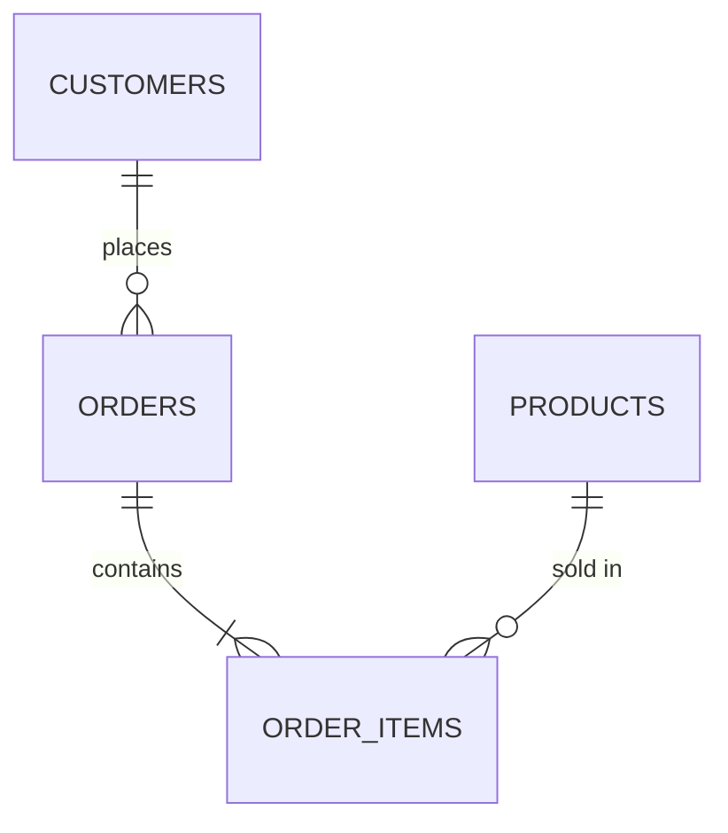

# Python — Data Analytics & Data Science Practice


A personal Python learning repository with **150 practice problems** for data analytics and data science, organised into beginner, intermediate and advanced levels. Every problem includes a worked answer and the actual output it produces, so you can run the code and check your results.

## Table of Contents

- [Project Overview](#project-overview)
- [Technologies](#technologies)
- [Repository Structure](#repository-structure)
- [Practice Topics](#practice-topics)
- [Sample Datasets](#sample-datasets)
- [Getting Started](#getting-started)
- [Study Workflow](#study-workflow)
- [Author](#author)

## Project Overview

This repository documents my self-study of Python for data work. The exercises follow the everyday tasks of a data analyst and data scientist: loading and cleaning data, summarising and reshaping it, analysing customers and sales over time, testing hypotheses and building machine learning models.

Each problem has four parts:

1. **Problem** – the business question or task
2. **Answer** – a working Python solution
3. 💡 **Note** – the key idea or a common pitfall
4. **Result** – the output produced by running the answer (tables or text)

## Technologies

- Python 3
- pandas 3.0 and NumPy 2.5 (data manipulation)
- SciPy 1.18 (statistical tests)
- scikit-learn 1.9 (machine learning)
- Jupyter Notebook / VS Code
- Markdown and GitHub

## Repository Structure

```text
Python-Practice/
├── README.md
├── 00_make_data.py
├── Python_150_Practice_Problems.md
└── data/
    ├── customers.csv
    ├── products.csv
    ├── orders.csv
    ├── order_items.csv
    ├── ab_test.csv
    ├── churn.csv
    └── messy_sales.csv
```

| File | Purpose |
|---|---|
| [`00_make_data.py`](00_make_data.py) | Creates the seven sample CSV files in `data/` (fixed random seed, identical on every run) |
| [`Python_150_Practice_Problems.md`](Python_150_Practice_Problems.md) | 150 problems with answers, notes and results |
| `data/` | The sample datasets used by every problem |
| `README.md` | Project overview and setup instructions |

## Practice Topics

| Level | Problems | Main topics |
|---|---:|---|
| 🟢 Beginner | 50 (B01–B50) | Lists, dictionaries, comprehensions, functions, f-strings, loading CSVs, `head`/`describe`/`dtypes`, filtering, sorting, `value_counts`, missing values, dates, `groupby`, `merge`, `concat`, duplicates, string cleaning, `map`, `apply`, `np.where`, `pd.cut`, `crosstab`, `pivot_table` |
| 🟡 Intermediate | 50 (I01–I50) | Named aggregation, `resample`, growth rates, rolling and expanding windows, `transform`, ranking and top N per group, `melt`/`pivot`/`unstack`, `np.select`, `qcut`, outlier detection, cleaning messy prices, dates and names, deduplication, imputation by group, recency, anti-joins, `explode`, Pareto analysis, YoY comparisons, NumPy broadcasting |
| 🔴 Advanced | 50 (A01–A50) | RFM segmentation, cohort retention, CLV, market basket analysis, A/B testing (z-test, chi-square, t-test, bootstrap, permutation test, sample size), regression, scikit-learn pipelines, model evaluation (ROC AUC, cross-validation, thresholds, lift), `GridSearchCV`, K-means, PCA, forecasting baselines, anomaly detection, `merge_asof`, memory optimisation, method chaining, `json_normalize`, regex, Gini coefficient, KPI reporting |
| **Total** | **150** | |

**[Open all 150 Python practice problems](Python_150_Practice_Problems.md)**

## Sample Datasets

The exercises use a fictional online retailer selling to customers in the Baltic states and Poland (2023–2024), plus two datasets for experiments and machine learning.

| Dataset | Rows | Description |
|---|---:|---|
| `customers` | 40 | Name, city, country, age, segment, signup date and email |
| `products` | 15 | Product name, category, price, cost and stock |
| `orders` | 240 | Order date, channel, status, discount and shipping days |
| `order_items` | 502 | Order lines with product, quantity and unit price |
| `ab_test` | 2,000 | Website experiment: group, device, conversion and revenue |
| `churn` | 800 | Subscription customers with contract, usage and churn flag |
| `messy_sales` | 15 | A deliberately dirty export for data-cleaning practice |
| **Total** | **3,612** | |



The data includes realistic edge cases such as missing values, customers without orders, a product that was never sold, cancelled and returned orders, orders dated before signup, mixed date formats and prices stored as text.

## Getting Started

### 1. Clone the repository

```bash
git clone https://github.com/imalgirdas/Python-Practice.git
cd Python-Practice
```

> Change the URL if you use a different repository name.

### 2. Install the libraries

```bash
pip install pandas numpy scipy scikit-learn tabulate
```

### 3. Create the sample data

The CSV files are already in `data/`. To recreate them:

```bash
python 00_make_data.py
```

### 4. Load the data

Start every notebook or script with the setup code from the [practice problems file](Python_150_Practice_Problems.md#setup). It loads the seven tables and builds a joined `sales` table used by many problems.

```python
import pandas as pd
import numpy as np

customers   = pd.read_csv("data/customers.csv")
orders      = pd.read_csv("data/orders.csv", parse_dates=["order_date"])
# ... see the Setup section for the full code
```

## Study Workflow

1. Open the [practice problems](Python_150_Practice_Problems.md).
2. Choose a problem by level and solve it on your own first.
3. Run your code on the sample data.
4. Compare your output with the documented answer and result.
5. Record your own improvements and alternative approaches.

Problems never change the original tables. If you experiment, work on a copy:

```python
df = orders.copy()
```

Results were produced with pandas 3.0. With pandas 2.x some outputs look slightly different (for example, text columns show as `object` instead of `str`), but the numbers are the same.

## Author

**Algirdas Vailionis** — Finance & Data Analytics Enthusiast

[GitHub](https://github.com/imalgirdas) · [LinkedIn](https://www.linkedin.com/in/algirdas-vailionis/) · [Email](mailto:algirdas.vailionis@gmail.com)

---

*Personal learning repository for educational and self-study purposes.*
